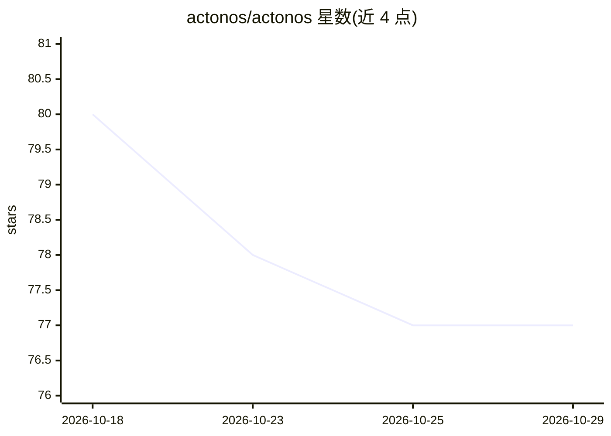

# actonos/actonos

⭐ 77 · Go · Apache-2.0 · 推送 2026-08-31 · [GitHub](https://github.com/actonos/actonos) · [官网](https://actonos.github.io/docs/) · 组织维护

**面向 MiniPC 的可扩展 AI Agent 操作系统内核，7x24 运行**

单一用途的设备型操作系统，以自治理 Agent 内核形式运行：核心守护进程 actond 静态编译（CGO_ENABLED=0），本地 ONNX 推理（multilingual-e5-small 嵌入）作为仅回环的辅助进程打包。支持创建无限 Agent（自定义 persona、系统提示、工具绑定、LLM 模型）、Goroutine 实现的 Agent 间委派编组、WASM 沙箱插件（wazero）、运行时热加载 MCP 服务器、SQLite FTS5+chromem-go 的 RAG 混合记忆、OAuth 2.1 认证、原子 OTA 与内嵌 Tailscale 远程访问。提供 Docker 镜像与裸机 ISO 两种部署形态；裸机基于 Debian 12 Minimal/Alpine。前端 React 19 通过 go:embed 内嵌。

## 筛选速览

| 维度 | 判定 | 备注 |
|---|---|---|
| AI 角色 | `ai-ecosystem` | LLM/agent 周边工具 |
| 许可风险 | `permissive` | Apache-2.0 |
| 部署形态 | `self-host` | docker 或自建部署 |
| 模型依赖 | — | README 未给出锁定关系 |
| 硬件要求 | — | 无带数字的原话,不猜 |
| 安装摩擦 | `low` | 无编译、无系统依赖或容器化 |
| 成熟度 | — | 结构信号不足 |

## 能力要点

- 静态单二进制核心守护进程 actond，本地 ONNX 嵌入推理独立打包
- 多 Agent 委派与 WasmLoader 沙箱插件引擎（wazero，出站防火墙+AES-256-GCM 密钥库）
- 运行时热加载 MCP 服务器、WASM 插件与 Skill-as-a-Folder 脚本
- 双运行时 HAL：自动检测裸机（D-Bus/Bubblewrap）或 Docker 环境

## 适用场景

- 把 MiniPC 刷成常驻的 AI Agent 设备，7x24 自动执行任务
- 在 Docker 容器中运行自治理 Agent 内核并通过 Web 仪表盘管理
- 通过 Tailscale 加密远程访问家庭/边缘设备上的 Agent 集群

## 场景标签

`Agent 框架` `Agent 记忆` `多智能体` · 领域:Agent 开发

## 证据(README 行号)

> L12: A single-purpose appliance OS designed as a **customizable, self-governing agent kernel** that runs 24/7. ActonOS k
> L21: |**Universal Agent Engine**|Create unlimited AI agents with custom personas, system prompts, tool bindings, LLM mod
> L26: |**Hybrid Memory (RAG)**|SQLite FTS5 + Chromem-go vectors generated locally by pinned multilingual-e5-small ONNX, w

## 星数曲线

2026-10-18 80 → 2026-10-29 77（-3）

---
*卡片 v1 · prompt 1.4 · 生成 2026-10-24 · 置信度 high · 依据 README sha `cbabb6db7d22` · [字段定义](../../DATASET.md)*
