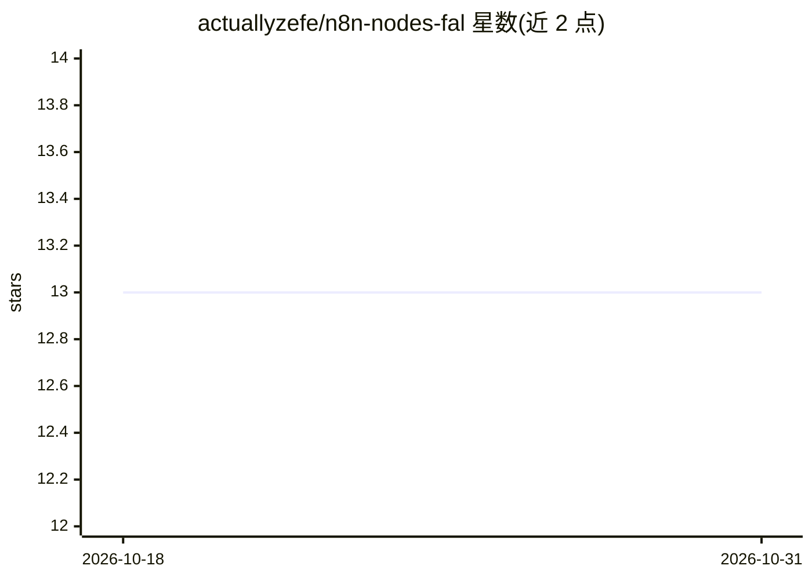

# actuallyzefe/n8n-nodes-fal

⭐ 13 · TypeScript · 推送 2026-02-03 · [GitHub](https://github.com/actuallyzefe/n8n-nodes-fal) · 个人维护

**n8n 社区节点：在 n8n 工作流中接入 fal.ai 生成式模型 API**

一个 TypeScript 编写的 n8n 社区节点包，封装 fal.ai 平台的模型 API，使 n8n 工作流可直接执行文生图、文生视频、图生视频与文本转语音四类操作，支持多模型选择、分辨率/宽高比/时长等参数、负向提示词、种子与批量生成。凭据通过 fal.ai API Key 配置并自动测试连通性；所有请求走 fal.ai 队列系统，节点每 5 秒轮询、最长等待 20 分钟，自动处理轮询、重试与超时，可多节点链式编排。通过 n8n UI 或 npm 手动安装，fal.ai 采用积分计价并提供免费档。

## 筛选速览

| 维度 | 判定 | 备注 |
|---|---|---|
| AI 角色 | `ai-ecosystem` | LLM/agent 周边工具 |
| 许可风险 | `none` | — |
| 部署形态 | `library` | 以包/库形式分发 |
| 模型依赖 | — | README 未给出锁定关系 |
| 硬件要求 | — | 无带数字的原话,不猜 |
| 安装摩擦 | `low` | 无编译、无系统依赖或容器化 |
| 成熟度 | — | 结构信号不足 |

## 能力要点

- 覆盖文生图/文生视频/图生视频/文本转语音四类操作
- 自动管理 fal.ai 队列：5 秒轮询、20 分钟超时、内置重试
- 支持负向提示词、种子、批量生成与多参考图生成
- 节点可链式编排（图片→视频→配音等复合工作流）

## 适用场景

- 在 n8n 工作流中直接调用 fal.ai 生成图片或视频
- 把静态图片转成动画视频并配 AI 语音旁白
- 批量生成内容并接入既有自动化流程

## 场景标签

`工作流自动化` `图像生成` `视频生成` `语音合成` · 领域:效率与自动化

## 证据(README 行号)

> L5: This is an n8n community node that lets you integrate fal.ai AI model APIs into your n8n workflows.
> L7: fal.ai is a platform for running AI models with fast inference, supporting text-to-image, image-to-video, and other 

## 星数曲线

2026-10-18 13 → 2026-10-31 13（+0）

---
*卡片 v1 · prompt 1.4 · 生成 2026-10-31 · 置信度 high · 依据 README sha `7827752b8a80` · [字段定义](../../DATASET.md)*
