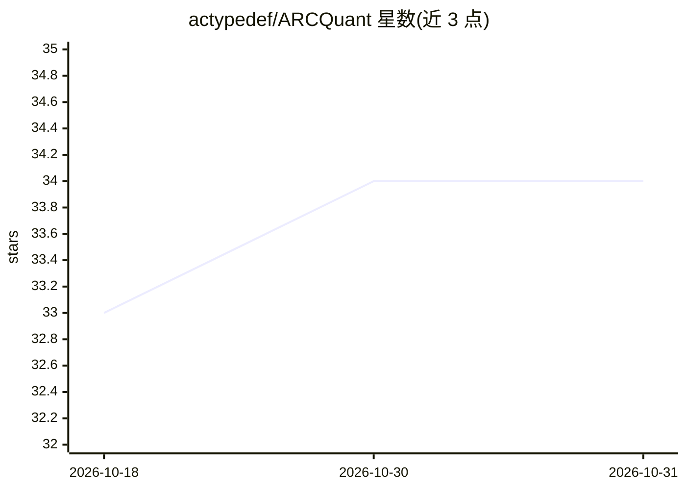

# actypedef/ARCQuant

⭐ 34 · Cuda · 推送 2026-09-21 · [GitHub](https://github.com/actypedef/ARCQuant) · 组织维护

**面向低比特 LLM 的 NVFP4 量化框架（ACL 2026 论文代码）**

论文配套的量化框架：针对 NVFP4 等细粒度低比特格式中激活离群值导致的精度损失，捕获关键通道的量化残差并以增广残差通道（ARC）方式融合回计算，避免传统混合精度拆分多分支带来的 kernel 启动开销与内存碎片。支持 NVFP4/MXFP4/HiF4/INT4 格式，提供 CUDA kernel 构建、reorder_indices 预处理与精度/效率评测脚本；已支持 vLLM 集成与 Mixtral，并已合入 NVIDIA TensorRT-LLM。面向具备 CUDA 12.8 环境的研究与推理开发者，从源码安装并编译 kernel。

## 筛选速览

| 维度 | 判定 | 备注 |
|---|---|---|
| AI 角色 | `ai-ecosystem` | LLM/agent 周边工具 |
| 许可风险 | `none` | — |
| 部署形态 | `library` | 以包/库形式分发 |
| 模型依赖 | local-ok | 支持本地模型 |
| 硬件要求 | — | 无带数字的原话,不猜 |
| 安装摩擦 | `medium` | 含编译或系统依赖之一 |
| 成熟度 | — | 结构信号不足 |

## 能力要点

- NVFP4/MXFP4/HiF4/INT4 多格式量化支持
- 增广残差通道（ARC）将关键通道残差融合回计算
- 提供 NVFP4 CUDA kernel 与预处理/评测脚本
- 已集成进 NVIDIA TensorRT-LLM，支持 vLLM 集成

## 适用场景

- 对 LLM 做 NVFP4 低比特量化并评测精度
- 在细粒度量化下缓解激活离群值导致的精度下降
- 复现论文结果或基于 vLLM 评测推理效率

## 场景标签

`模型量化` · 领域:训练与推理

## 证据(README 行号)

> L8: **ARCQuant** is a high-performance quantization framework for low-bit LLMs that improves accuracy under fine-grained
> L71: ARCQuant supports multiple formats, including NVFP4, MXFP4, HiF4, and INT4. You can modify the `quant_type` paramet
> L36: Please make sure that CUDA 12.8 is available in your environment.

## 星数曲线

2026-10-18 33 → 2026-10-31 34（+1）

---
*卡片 v1 · prompt 1.4 · 生成 2026-10-25 · 置信度 mid · 依据 README sha `72a4843c33a3` · [字段定义](../../DATASET.md)*
