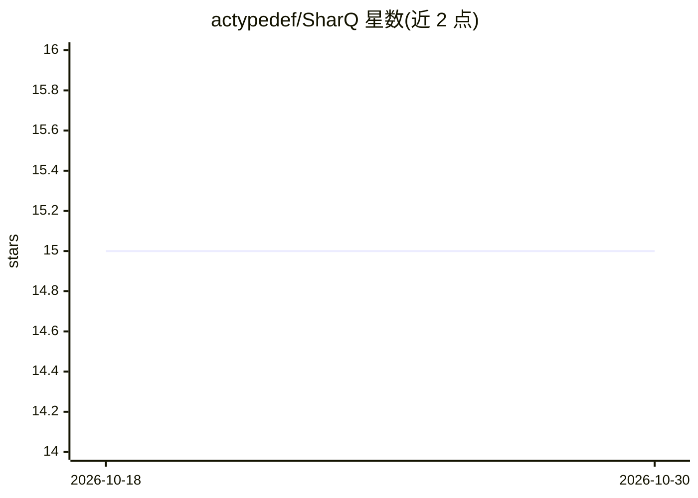

# actypedef/SharQ

⭐ 15 · Python · 推送 2026-10-28 · [GitHub](https://github.com/actypedef/SharQ) · 组织维护

**面向 Blackwell GPU 的 LLM 稀疏+FP4 量化推理库**

论文配套代码库：提出用稀疏 FP4 主路径捕捉重要激活、稠密 FP4 残差路径恢复精度损失的量化方法。提供三种模式：NVFP4 稠密基线、SHARQ 融合稀疏-残差 CUDA 核路径（需 RTX 50/Blackwell sm_120a 或 B200 sm_100a，编译 CUDA 扩展）、SHARQ_SIM 纯 PyTorch 仿真参考（无需编译）。包含困惑度与 zero-shot lm-eval 评测脚本、正确性/性能/端到端/消融基准、单轮与多轮本地聊天 demo，支持 Llama/Qwen2/Mixtral 模型。

## 筛选速览

| 维度 | 判定 | 备注 |
|---|---|---|
| AI 角色 | `ai-ecosystem` | LLM/agent 周边工具 |
| 许可风险 | `none` | — |
| 部署形态 | `library` | 以包/库形式分发 |
| 模型依赖 | — | README 未给出锁定关系 |
| 硬件要求 | — | 无带数字的原话,不猜 |
| 安装摩擦 | `high` | 编译与系统依赖俱全 |
| 成熟度 | — | 结构信号不足 |

## 能力要点

- 稀疏 FP4 主路径 + 稠密 FP4 残差路径的量化方案
- SHARQ_SIM 仿真模式无需 CUDA 扩展即可做精度参考
- CUTLASS 稀疏 GEMM 集成与可编译 CUDA 扩展（sm_120a/sm_100a）
- 覆盖困惑度、zero-shot lm-eval 与 prefill 端到端基准脚本

## 适用场景

- 在 RTX 50/B200 上以 FP4 量化运行 LLM 推理
- 复现论文的量化精度与性能评测结果
- 对比 BF16、NVFP4、SHARQ 的 prefill 性能

## 场景标签

`模型量化` `模型评测` · 领域:评测与运维

## 证据(README 行号)

> L5: SharQ is a Blackwell-oriented LLM quantization repo built around this idea: use a sparse FP4 main path to capture im
> L12: - `SHARQ`: fused sparse-residual FP4 kernel path

## 星数曲线

2026-10-18 15 → 2026-10-30 15（+0）

---
*卡片 v1 · prompt 1.4 · 生成 2026-10-30 · 置信度 mid · 依据 README sha `f3ca79e8ab6b` · [字段定义](../../DATASET.md)*
