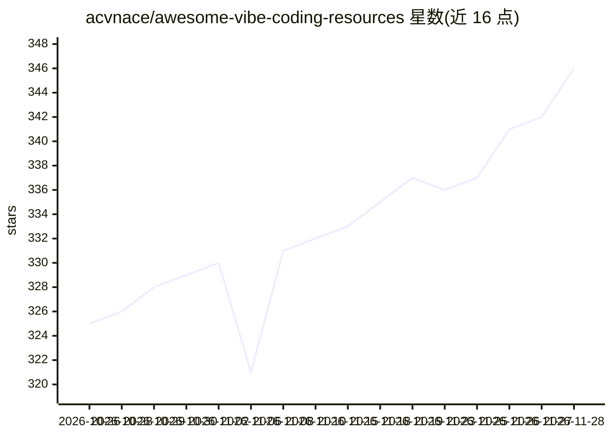

# acvnace/awesome-vibe-coding-resources

⭐ 346 · Python · MIT · 推送 2026-11-27 · [GitHub](https://github.com/acvnace/awesome-vibe-coding-resources) · [官网](https://yangmao.ai) · 个人维护 · 中文 README

**面向 vibe coding 开发者的工具与资源策展清单**

以 awesome-list 形式组织的 vibe coding 资源目录，收录浏览器端 AI 应用构建工具、移动端优先工具、AI 代码编辑器与桌面应用等类别的条目，每条附一句事实性简介；包含对 vibe coding 概念的来源说明（Andrej Karpathy 定义）以及投稿贡献规则（需 Star 仓库、通过审查与检查）。清单本身不提供可安装软件，收录对象多为第三方产品与开源项目。

## 筛选速览

| 维度 | 判定 | 备注 |
|---|---|---|
| AI 角色 | `ai-knowledge` | 知识聚合/清单类 |
| 许可风险 | `permissive` | MIT |
| 部署形态 | `self-host` | docker 或自建部署 |
| 模型依赖 | — | README 未给出锁定关系 |
| 硬件要求 | — | 无带数字的原话,不猜 |
| 安装摩擦 | `low` | 无编译、无系统依赖或容器化 |
| 成熟度 | — | 结构信号不足 |

## 能力要点

- 按 Browser-based Tools、Mobile-first Tools、IDEs、Desktop Apps 等类别组织的条目清单
- 收录 vibe coding 概念定义来源（Karpathy 于 X 的表述）
- 明文的贡献规范：事实性描述、禁止广告与联盟链接、利益关联需披露

## 适用场景

- 查找用自然语言描述生成应用的开发工具
- 对比不同 AI 代码编辑器与 agent 运行界面
- 为该清单贡献新的 vibe coding 资源条目

## 场景标签

`精选清单` · 领域:学习与行业

## 证据(README 行号)

> L1: # Awesome Vibe Coding Resources
> L3: > :clipboard: A curated list about vibe coding tools, resources and news
> L9: Add resources that help people build, test, or ship software with AI. Use the relevant section and give a short, fac

## 星数曲线

2026-10-26 325 → 2026-11-28 346（+21）

---
*卡片 v1 · prompt 1.4 · 生成 2026-11-28 · 置信度 mid · 依据 README sha `0645ff4dbc3b` · [字段定义](../../DATASET.md)*
