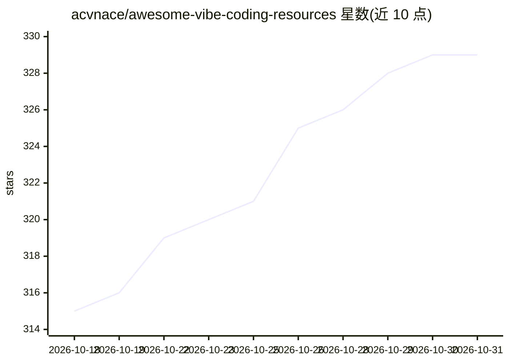

# acvnace/awesome-vibe-coding-resources

⭐ 329 · MIT · 推送 2026-10-30 · [GitHub](https://github.com/acvnace/awesome-vibe-coding-resources) · [官网](https://yangmao.ai) · 个人维护

**vibe coding 工具与资源的策展清单**

一个 awesome 风格的 curated list，收录 vibe coding 相关的工具、资源与新闻，按浏览器端工具、移动端工具、IDE 与代码编辑器、桌面应用等类别组织。条目覆盖 Bolt.new、Lovable、v0、Cursor、Windsurf 等网页/应用生成与 AI 编码工具，大量条目为围绕 Claude Code、Codex 等 CLI 编码代理的配套桌面应用。同时收录 Karpathy 对 vibe coding 的原始定义引述。面向寻找 AI 编码工具的开发者与选型用户。

## 筛选速览

| 维度 | 判定 | 备注 |
|---|---|---|
| AI 角色 | `ai-knowledge` | 知识聚合/清单类 |
| 许可风险 | `permissive` | MIT |
| 部署形态 | `self-host` | docker 或自建部署 |
| 模型依赖 | — | README 未给出锁定关系 |
| 硬件要求 | — | 无带数字的原话,不猜 |
| 安装摩擦 | `low` | 无编译、无系统依赖或容器化 |
| 成熟度 | — | 结构信号不足 |

## 能力要点

- 按浏览器端/移动端/IDE/桌面应用等类别组织条目
- 收录 Karpathy 的 vibe coding 定义原文
- 包含大量开源/自托管编码代理配套工具条目

## 适用场景

- 挑选浏览器端或移动端 AI 应用生成工具
- 查找 Claude Code/Codex 等编码代理的配套桌面应用
- 了解 vibe coding 工具生态概览

## 场景标签

`精选清单` · 领域:学习与行业

## 证据(README 行号)

> L3: > :clipboard: A curated list about vibe coding tools, resources and news
> L7: ## Contents

## 星数曲线

2026-10-18 315 → 2026-10-31 329（+14）

---
*卡片 v1 · prompt 1.4 · 生成 2026-10-21 · 置信度 mid · 依据 README sha `0fec0b3ac225` · [字段定义](../../DATASET.md)*
