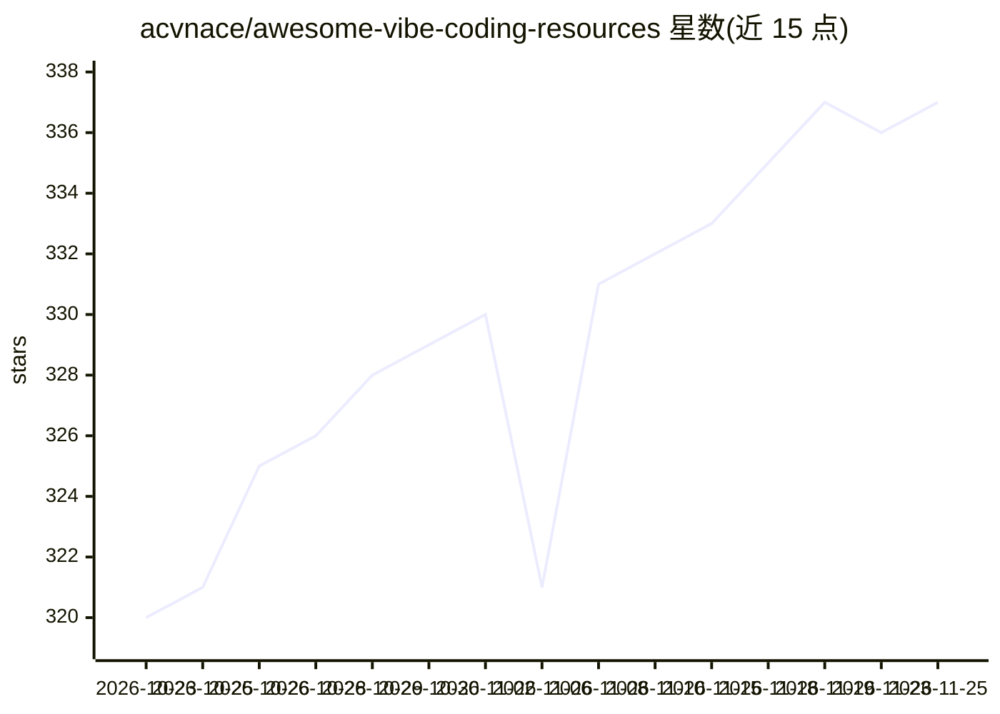

# acvnace/awesome-vibe-coding-resources

⭐ 337 · Shell · MIT · 推送 2026-11-23 · [GitHub](https://github.com/acvnace/awesome-vibe-coding-resources) · [官网](https://yangmao.ai) · 个人维护

**给 vibe coding 开发者的工具与资源策展清单**

一个关于 vibe coding 的资源聚合清单，按类别组织收录条目：概念释义、浏览器端 AI 应用构建工具、移动优先工具、AI 代码编辑器与 IDE、桌面端 agent 应用等。条目以短描述列出第三方产品/项目名称与链接，含开源与商业产品。README 定义了社区贡献规则：需在对应分区添加有事实性简述的资源，要求披露利益关联、排除广告与联盟链接。清单本身不提供代码或安装方式，仅作索引。

## 筛选速览

| 维度 | 判定 | 备注 |
|---|---|---|
| AI 角色 | `ai-knowledge` | 知识聚合/清单类 |
| 许可风险 | `permissive` | MIT |
| 部署形态 | `self-host` | docker 或自建部署 |
| 模型依赖 | — | README 未给出锁定关系 |
| 硬件要求 | — | 无带数字的原话,不猜 |
| 安装摩擦 | `low` | 无编译、无系统依赖或容器化 |
| 成熟度 | — | 结构信号不足 |

## 能力要点

- 按类别组织的 vibe coding 工具与资源清单
- 条目覆盖浏览器构建工具、移动工具、IDE、桌面应用等分区
- 附 Karpathy 对 vibe coding 概念的定义与释义链接
- README 给出社区贡献与利益披露规则

## 适用场景

- 想了解 vibe coding 生态里有哪些工具可选用
- 为自己的 AI 编码工作流找浏览器端构建器或 agent 桌面工具
- 检索可自托管的 Claude Code/Codex 会话管理工具

## 场景标签

`精选清单` · 领域:学习与行业

## 证据(README 行号)

> L3: > :clipboard: A curated list about vibe coding tools, resources and news
> L11: ## Contents
> L80: ## IDEs and Code Editors

## 星数曲线

2026-10-23 320 → 2026-11-25 337（+17）

---
*卡片 v1 · prompt 1.4 · 生成 2026-11-25 · 置信度 mid · 依据 README sha `5bdeccb57f6e` · [字段定义](../../DATASET.md)*
