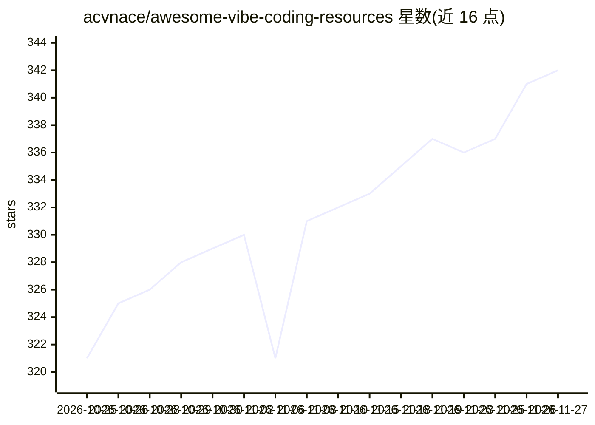

# acvnace/awesome-vibe-coding-resources

⭐ 342 · Python · MIT · 推送 2026-11-26 · [GitHub](https://github.com/acvnace/awesome-vibe-coding-resources) · [官网](https://yangmao.ai) · 个人维护

**面向 AI 辅助开发者的 vibe coding 资源策展清单**

以 awesome-list 形式组织的 vibe coding 资源聚合，按浏览器工具、移动端工具、IDE 与代码编辑器、桌面应用等章节分类收录条目，每条附一句事实性描述。开头收录 vibe coding 概念定义与 Karpathy 的术语出处，贡献规则要求投稿者披露利益关联、排除广告与联盟链接。清单本身不提供可安装的软件，内容为指向第三方工具与资源的条目列表。

## 筛选速览

| 维度 | 判定 | 备注 |
|---|---|---|
| AI 角色 | `ai-knowledge` | 知识聚合/清单类 |
| 许可风险 | `permissive` | MIT |
| 部署形态 | `self-host` | docker 或自建部署 |
| 模型依赖 | — | README 未给出锁定关系 |
| 硬件要求 | — | 无带数字的原话,不猜 |
| 安装摩擦 | `low` | 无编译、无系统依赖或容器化 |
| 成熟度 | — | 结构信号不足 |

## 能力要点

- 按 Browser-based/Mobile/IDE/Desktop 等章节分类组织条目
- 收录 vibe coding 术语出处与概念解释链接
- 贡献规则要求披露利益关联、排除广告与联盟链接

## 适用场景

- 寻找可用的 AI 编程与 prompt 建站工具
- 了解 vibe coding 生态里有哪些新工具
- 浏览各类支持 AI agent 的 IDE 与编辑器选项

## 场景标签

`精选清单` · 领域:学习与行业

## 证据(README 行号)

> L1: # Awesome Vibe Coding Resources
> L3: > :clipboard: A curated list about vibe coding tools, resources and news
> L11: ## Contents

## 星数曲线

2026-10-25 321 → 2026-11-27 342（+21）

---
*卡片 v1 · prompt 1.4 · 生成 2026-11-26 · 置信度 mid · 依据 README sha `427e817db5e4` · [字段定义](../../DATASET.md)*
