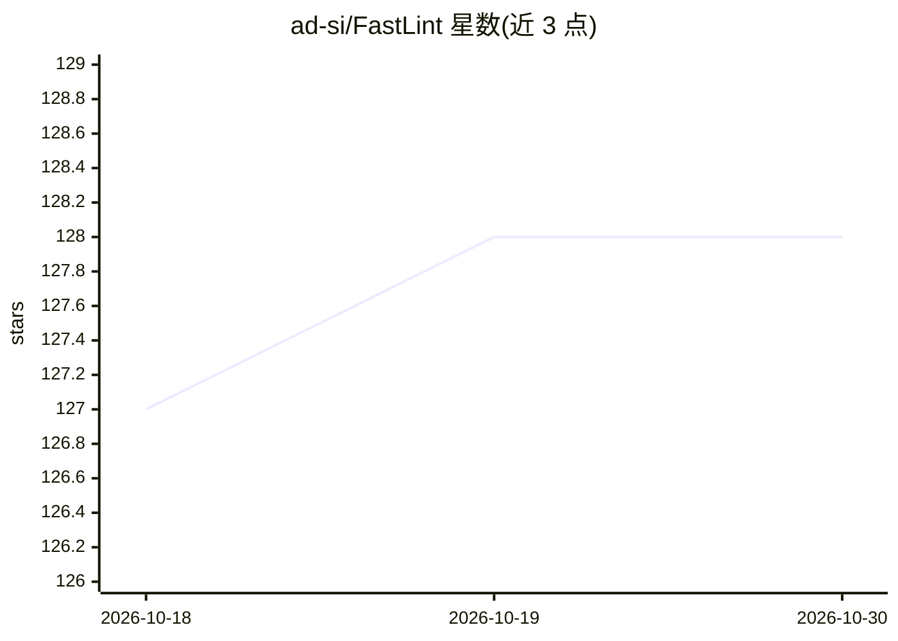

# ad-si/FastLint

⭐ 128 · Rust · 推送 2026-05-12 · [GitHub](https://github.com/ad-si/FastLint) · [官网](https://fastlint.com) · 个人维护

**多语言通用的文件检查 linter，让 vibe coding 更安全**

以 Rust 编写的命令行 linter，可检查任意编程语言的文件。实现方式不是自研分析，而是打包 crates.io 上的开源检查器。当前包含三类检查：typos 拼写检查（warning）、未解决的合并冲突标记（error）、行尾空白（warning）。支持指定目录或文件、输出 JSON 格式诊断、定义退出码（0/1/2）；自动跳过 .gitignore、.ignore、隐藏文件及二进制/锁文件。通过 cargo 从 crates.io 或本地源码安装。README 中未描述模型调用或 AI 功能，仅主题标签含 ai/vibe-coding。

## 筛选速览

| 维度 | 判定 | 备注 |
|---|---|---|
| AI 角色 | `ai-enhanced` | 去掉 AI 部分产品仍成立 |
| 许可风险 | `none` | — |
| 部署形态 | `library` | 以包/库形式分发 |
| 模型依赖 | — | README 未给出锁定关系 |
| 硬件要求 | — | 无带数字的原话,不猜 |
| 安装摩擦 | `low` | 无编译、无系统依赖或容器化 |
| 成熟度 | — | 结构信号不足 |

## 能力要点

- 打包 crates.io 开源检查器，不重复实现分析
- 检查任意编程语言文件：拼写、合并冲突标记、行尾空白
- 支持 --json 诊断输出与退出码 0/1/2
- 自动跳过 .gitignore/.ignore、隐藏文件与二进制/锁文件

## 适用场景

- 提交前快速检查代码中的拼写与合并冲突问题
- 在 CI 流程中用退出码判断是否存在错误级诊断
- 以 JSON 输出集成到其他工具

## 场景标签

 · 领域:开发工具/静态代码分析

## 证据(README 行号)

> L38: |`typos`|warning|`typos` source-code spell-checker|
> L39: |`merge-conflict`|error|unresolved `<<<<<<<` / `=======` / `>>>>>>>` markers|
> L40: |`trailing-whitespace`|warning|trailing spaces/tabs at end of line|

## 星数曲线

2026-10-18 127 → 2026-10-30 128（+1）

---
*卡片 v1 · prompt 1.4 · 生成 2026-10-22 · 置信度 low · 依据 README sha `cd755b1e0b3d` · [字段定义](../../DATASET.md)*
