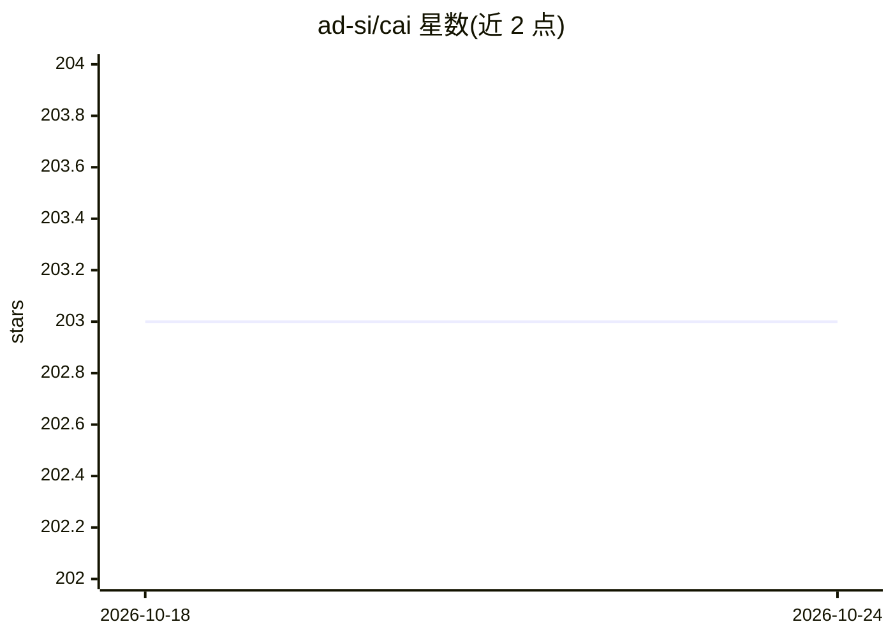

# ad-si/cai

⭐ 203 · Rust · ISC · 推送 2026-10-17 · [GitHub](https://github.com/ad-si/cai) · [官网](https://crates.io/crates/cai) · 个人维护

**终端用户的多模型 AI 任务 CLI：一条命令产出文本/图像/视频等结果**

Rust 编写的命令行工具，用高层子命令（value/image/video/music/ocr/rewrite/box 等）直接调用多家模型服务，覆盖 Anthropic、OpenAI、Google、Groq、Cerebras、DeepSeek、xAI、Black Forest Labs、TypeSafe 等云端 API，以及 Ollama/Llamafile 本地模型和 Apple 端侧模型。支持同时向多个模型发提示、通过订阅（Codex/Claude Code CLI）计费而非 API key、设置首选提供商。使用前需配置 API key 或本地服务。

## 筛选速览

| 维度 | 判定 | 备注 |
|---|---|---|
| AI 角色 | `ai-native` | 本体是模型或模型工具 |
| 许可风险 | `permissive` | ISC |
| 部署形态 | `library` | 以包/库形式分发 |
| 模型依赖 | local-ok | 支持本地模型 |
| 硬件要求 | — | 无带数字的原话,不猜 |
| 安装摩擦 | `low` | 无编译、无系统依赖或容器化 |
| 成熟度 | — | 结构信号不足 |

## 能力要点

- 高层子命令覆盖文本、图像、视频、音乐生成、OCR、改写等任务
- 接入 10+ 云端提供商与 Ollama/Llamafile/Apple 本地模型
- 可将 OpenAI/Anthropic 请求经 Codex/Claude Code CLI 计入订阅额度
- 支持同时向多个模型发送提示

## 适用场景

- 在终端直接生成文本、图像、视频、音乐内容
- 对剪贴板内容做改写、判断或对象定位
- 用订阅额度而非 API key 日常调用模型
- 在多个提供商与本地模型间切换

## 场景标签

`AI 助手` `图像生成` `OCR` · 领域:对话与助手

## 证据(README 行号)

> L8:  - `cai value capital of Australia`
> L33:  - Local LLMs via [Ollama] and [Llamafile]

## 星数曲线

2026-10-18 203 → 2026-10-24 203（+0）

---
*卡片 v1 · prompt 1.4 · 生成 2026-10-22 · 置信度 high · 依据 README sha `9bdf3de6154f` · [字段定义](../../DATASET.md)*
