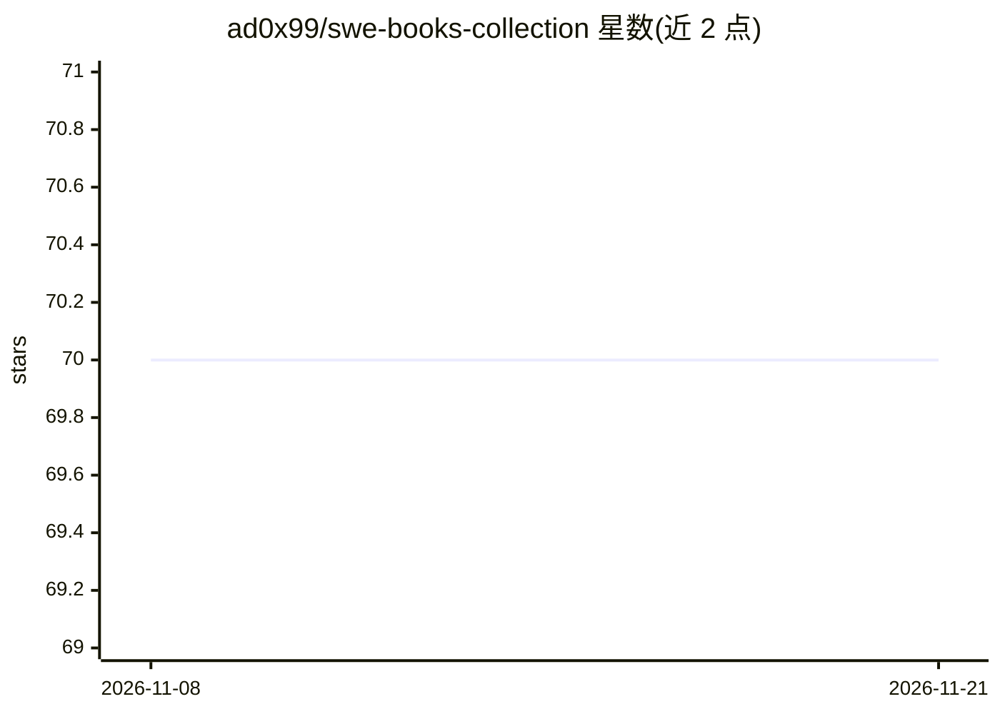

# ad0x99/swe-books-collection

⭐ 70 · 推送 2026-11-04 · [GitHub](https://github.com/ad0x99/swe-books-collection) · 个人维护

**软件工程书籍合集仓库，已归档且不再提供书籍**

原作者曾在此仓库存放软件工程书籍合集，后因 Git LFS 限制迁移至 Notion 页面，该页面又因版权规则被 Notion 下架。当前仓库仅保留 README 发布状态更新：书籍不再从仓库或 Notion 提供，仓库暂时关闭，作者表示正在寻找其他免费托管服务并可能后续更新。面向寻找软件工程学习资料的读者，但现在无可下载内容。

## 筛选速览

| 维度 | 判定 | 备注 |
|---|---|---|
| AI 角色 | `ai-knowledge` | 知识聚合/清单类 |
| 许可风险 | `none` | — |
| 部署形态 | `None` |  |
| 模型依赖 | — | README 未给出锁定关系 |
| 硬件要求 | — | 无带数字的原话,不猜 |
| 安装摩擦 | `low` | 无编译、无系统依赖或容器化 |
| 成熟度 | — | 结构信号不足 |

## 能力要点

- 曾收录软件工程书籍合集（涵盖编程语言、设计模式、DevOps 等主题）
- 因 Git LFS 限制迁移至 Notion，后被版权规则下架
- 目前仅保留 README 作为状态公告

## 适用场景

- 查看仓库当前状态与后续更新说明
- 了解原书籍合集的存在与去向

## 场景标签

`精选清单` · 领域:学习与行业

## 证据(README 行号)

> L1: # Software Engineering Books Collection
> L7: Previously, I used this repo to store my collection of software engineering books 📚. Due to the Git LFS limitation, 

## 星数曲线

2026-11-08 70 → 2026-11-21 70（+0）

---
*卡片 v1 · prompt 1.4 · 生成 2026-11-18 · 置信度 mid · 依据 README sha `0addb1d6c4f8` · [字段定义](../../DATASET.md)*
