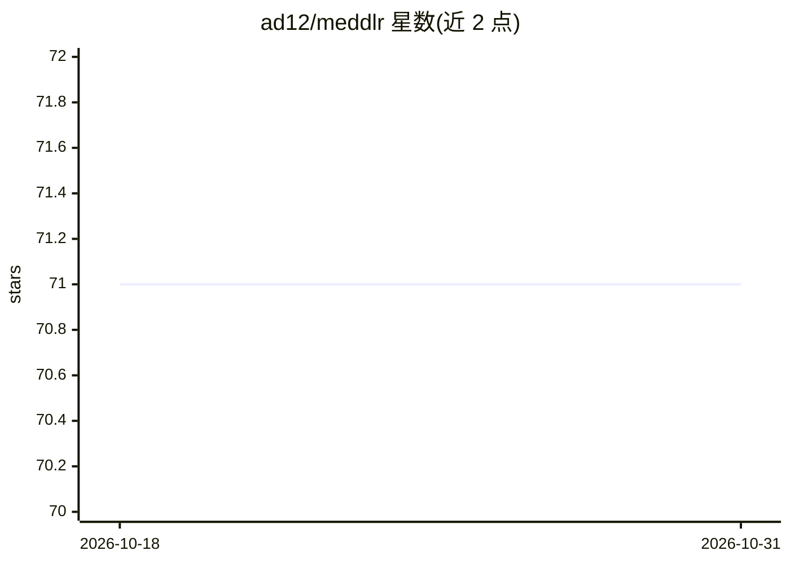

# ad12/meddlr

⭐ 71 · Python · Apache-2.0 · 推送 2026-02-10 · [GitHub](https://github.com/ad12/meddlr) · 个人维护

**医学影像重建与分析实验的配置驱动 ML 框架**

面向医学影像（如 MRI）重建与分析的配置驱动机器学习框架，用于简化相关实验的搭建与基准测试。支持通过 pip 安装基础或全部依赖，提供 MeddlrViz 可视化工具（独立 pip 包）和模型动物园，可从 HuggingFace URL 加载预训练模型（配置文件 + 权重）。设计借鉴 detectron2，聚焦快速实验与基准测试。附带的引用文献为 Noise2Recon（MRI 重建与去噪半监督框架）。

## 筛选速览

| 维度 | 判定 | 备注 |
|---|---|---|
| AI 角色 | `ai-ecosystem` | LLM/agent 周边工具 |
| 许可风险 | `permissive` | Apache-2.0 |
| 部署形态 | `library` | 以包/库形式分发 |
| 模型依赖 | — | README 未给出锁定关系 |
| 硬件要求 | — | 无带数字的原话,不猜 |
| 安装摩擦 | `low` | 无编译、无系统依赖或容器化 |
| 成熟度 | — | 结构信号不足 |

## 能力要点

- 配置驱动的医学影像重建与分析实验框架
- 模型动物园支持从 HuggingFace URL 加载预训练模型
- 配套 MeddlrViz 可视化工具包
- 提供基础版与全功能版两种 pip 安装选项

## 适用场景

- 搭建和迭代医学影像（MRI）重建与分析实验
- 加载预训练模型进行医学影像任务基准测试
- 可视化医学影像数据集与模型结果

## 场景标签

`科研工具` `模型训练` · 领域:学习与行业

## 证据(README 行号)

> L10: Meddlr is a config-driven ML framework built to simplify medical image reconstruction and analysis problems.
> L65: Meddlr's design for rapid experimentation and benchmarking is inspired by detectron2.

## 星数曲线

2026-10-18 71 → 2026-10-31 71（+0）

---
*卡片 v1 · prompt 1.4 · 生成 2026-10-24 · 置信度 high · 依据 README sha `890f29ba81c2` · [字段定义](../../DATASET.md)*
