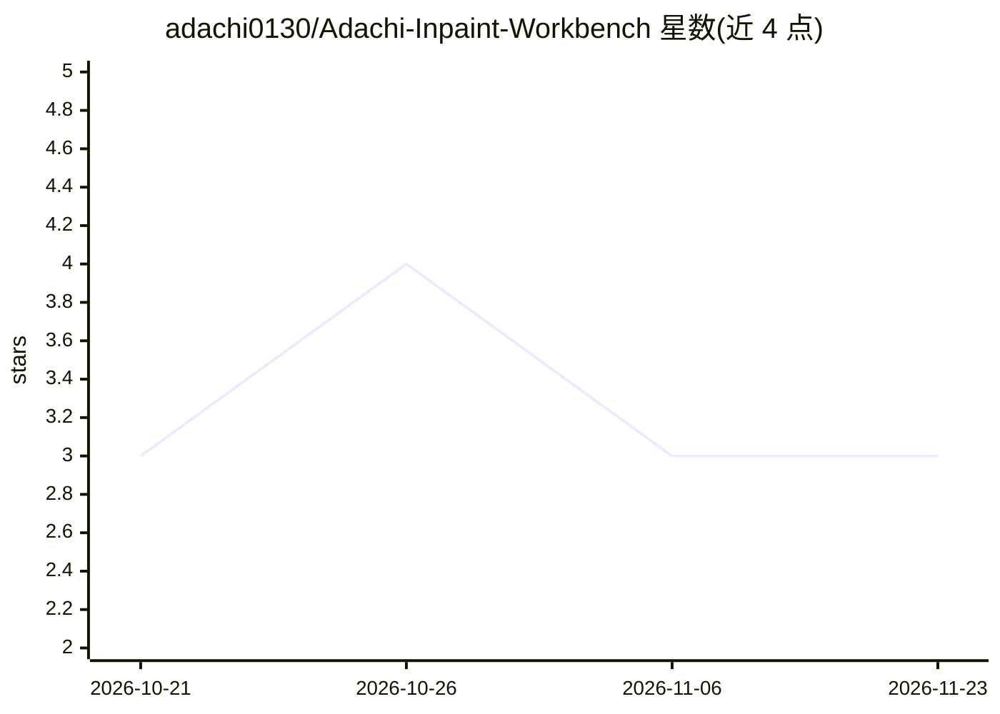

# adachi0130/Adachi-Inpaint-Workbench

⭐ 3 · JavaScript · GPL-3.0 · 推送 2026-11-22 · [GitHub](https://github.com/adachi0130/Adachi-Inpaint-Workbench) · 个人维护 · 中文 README

**ComfyUI 内联蒙版局部重绘与图像对比节点包**

面向 ComfyUI 的自定义节点集合，将重绘流程留在图上完成：Inline Mask 节点支持直接在图上绘制蒙版/裁剪/色彩涂抹，Workbench 节点提供 WebUI 风格的重绘控制（整图或仅蒙版区域采样、denoise、sampler、CFG、Refiner 等）并按源分辨率合成回原图，Image Compare 节点支持悬停对比与一键采纳结果继续编辑。模型、VAE、文本编码器与 LoRA 链从原生执行图自动发现，界面随 ComfyUI 语言设置支持中英文。需 Python 3.10+，依赖 ComfyUI 已有的 PyTorch/NumPy/Pillow。

## 筛选速览

| 维度 | 判定 | 备注 |
|---|---|---|
| AI 角色 | `ai-native` | 本体是模型或模型工具 |
| 许可风险 | `viral` | GPL-3.0 |
| 部署形态 | `None` |  |
| 模型依赖 | — | README 未给出锁定关系 |
| 硬件要求 | — | 无带数字的原话,不猜 |
| 安装摩擦 | `low` | 无编译、无系统依赖或容器化 |
| 成熟度 | — | 结构信号不足 |

## 能力要点

- Inline Mask 节点支持蒙版绘制、裁剪与双层混合，蒙版保留在浏览器并随工作流保存
- 整图/仅蒙版两种采样模式，结果按源图像分辨率返回
- 从原生执行图发现模型、VAE、文本编码器与 LoRA 链，支持 Get/Set 与子图
- Group Bypass Presets 一键切换启用的分支组合

## 适用场景

- 在 ComfyUI 图上直接涂抹蒙版做局部重绘
- 生成后悬停对比原图与结果并采纳继续下一轮编辑
- 在多个工作流分支间一键切换并路由到共享输出

## 场景标签

`图像生成` · 领域:内容生成

## 证据(README 行号)

> L5: An inline inpainting workspace for ComfyUI, with WebUI-style controls and tools for switching workflow branches.
> L27: |**Adachi Inpaint Workbench**|Whole-image or masked-area sampling, familiar inpainting controls and compositing bac
> L32: English and Simplified Chinese interfaces follow the ComfyUI language setting. The plugin uses the PyTorch, NumPy a

## 星数曲线

2026-10-21 3 → 2026-11-23 3（+0）

---
*卡片 v1 · prompt 1.4 · 生成 2026-11-22 · 置信度 mid · 依据 README sha `d7d83fa1a87c` · [字段定义](../../DATASET.md)*
