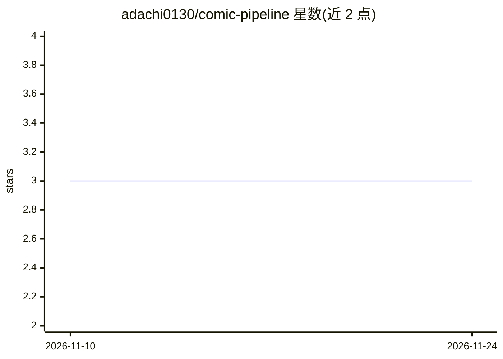

# adachi0130/comic-pipeline

⭐ 3 · Python · GPL-3.0 · 推送 2026-11-16 · [GitHub](https://github.com/adachi0130/comic-pipeline) · 个人维护 · 中文 README

**给漫画创作者：从大纲到成册 PDF 的 AI 漫画流水线**

本地 Web 应用（FastAPI/uvicorn），把故事大纲经正文、分镜、逐格提示词、出图、版面合成、导出六个阶段串成流水线，每个阶段产出带版本与血缘的产物，修改只向下游传播失效；每道门可设 manual 或 auto，同一套代码支持精修与无人值守批跑。正文经 SillyTavern 扩展与常驻桥生成，出图接任意可达的 ComfyUI 实例（本地/云端/SSH 隧道），页面编辑提供 69 个版式模板。ComfyUI、SillyTavern、LLM key 均为可选，缺省时后端仍可启动，仅对应功能不可用。

## 筛选速览

| 维度 | 判定 | 备注 |
|---|---|---|
| AI 角色 | `ai-native` | 本体是模型或模型工具 |
| 许可风险 | `viral` | GPL-3.0 |
| 部署形态 | `desktop` | 安装包/桌面程序 |
| 模型依赖 | local-ok | 支持本地模型 |
| 硬件要求 | — | 无带数字的原话,不猜 |
| 安装摩擦 | `low` | 无编译、无系统依赖或容器化 |
| 成熟度 | `idea` | |

## 能力要点

- 六阶段流水线，产物版本化+血缘失效传播，每道门可 manual/auto
- SillyTavern 扩展桥复用角色卡、世界书、预设；常驻桥免开标签页
- ComfyUI 工作流导入（API/UI 格式）与参数自动映射，本地/云端/SSH 隧道
- 69 个版式模板的页面编辑器，一键导出整册 PDF/CBZ

## 适用场景

- 从一个大纲批量产出可翻页的整册漫画
- 逐格调整提示词、LoRA 与采样参数并对比候选图
- 设置 auto 后无人值守跑完 S1→S6 全流程

## 场景标签

`图像生成` · 领域:内容生成

## 证据(README 行号)

> L5: An end-to-end, human-in-the-loop pipeline that turns a story outline into a paginated,
> L53: |🧩|**AI storyboarding**|LLM proposes page layouts and panel splits; you can edit them|
> L158: **LLM** — any OpenAI-compatible endpoint (DashScope, DeepSeek, Kimi, Zhipu, OpenRouter,

## 星数曲线

2026-11-10 3 → 2026-11-24 3（+0）

---
*卡片 v1 · prompt 1.4 · 生成 2026-11-22 · 置信度 mid · 依据 README sha `2e38325ed041` · [字段定义](../../DATASET.md)*
