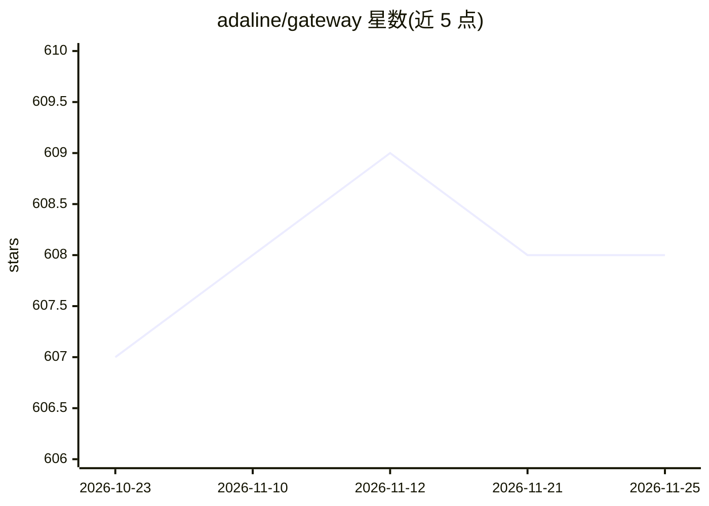

# adaline/gateway

⭐ 608 · TypeScript · MIT · 推送 2026-11-23 · [GitHub](https://github.com/adaline/gateway) · [官网](https://www.adaline.ai/docs) · 组织维护

**本地运行的 TypeScript SDK：统一接口调用 300+ LLM**

以 npm 包形式提供的 LLM 调用网关 SDK，为 OpenAI、Anthropic、Google 等多家模型服务提供统一接口，内置批处理、指数退避重试、缓存、回调与 OpenTelemetry 集成，并支持自定义插件与自定义 Provider。完全本地运行、非代理模式；Provider 依赖包可选按需安装；覆盖文本/图像消息、工具调用与推理内容的类型定义与格式转换。

## 筛选速览

| 维度 | 判定 | 备注 |
|---|---|---|
| AI 角色 | `ai-ecosystem` | LLM/agent 周边工具 |
| 许可风险 | `permissive` | MIT |
| 部署形态 | `library` | 以包/库形式分发 |
| 模型依赖 | locked-api |  |
| 硬件要求 | — | 无带数字的原话,不猜 |
| 安装摩擦 | `low` | 无编译、无系统依赖或容器化 |
| 成熟度 | — | 结构信号不足 |

## 能力要点

- 统一接口调用 300+ LLM，Provider 依赖包按需安装
- 完全本地运行、非代理，可部署于自有基础设施
- 内置批处理、重试、缓存、回调与 OpenTelemetry 集成
- 覆盖工具调用、图像内容与推理内容的类型系统

## 适用场景

- 在 TypeScript 应用中用一套代码切换多家 LLM 服务
- 为 LLM 调用统一添加重试、缓存与可观测性
- 接入 OpenAI 兼容的本地或自定义模型

## 场景标签

`模型网关` · 领域:Agent 开发

## 证据(README 行号)

> L8: The only fully local, production-grade Super SDK that provides a simple, unified, and powerful interface for calling
> L29: ### Providers
> L51: npm install @adaline/gateway @adaline/types

## 星数曲线

2026-10-23 607 → 2026-11-25 608（+1）

---
*卡片 v1 · prompt 1.4 · 生成 2026-11-25 · 置信度 high · 依据 README sha `5daf7913c229` · [字段定义](../../DATASET.md)*
