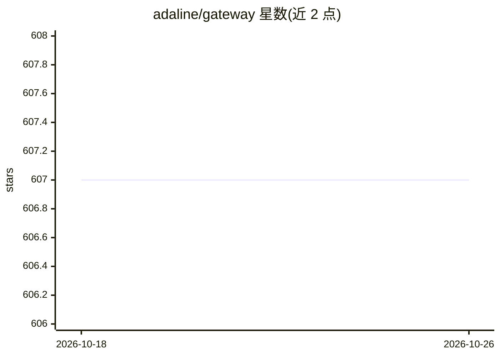

# adaline/gateway

⭐ 607 · TypeScript · MIT · 推送 2026-07-29 · [GitHub](https://github.com/adaline/gateway) · [官网](https://www.adaline.ai/docs) · 组织维护

**TypeScript 统一 LLM 调用 SDK：本地调用 300+ 模型**

面向 TypeScript 开发者的 LLM Super SDK：以统一类型接口调用 OpenAI、Anthropic、Google、Bedrock、Azure 等 11 类 provider 的对话与嵌入模型，并做 Config/Message/Tool 等类型与各 provider schema 的双向转换。运行在本地、非代理，内置批处理、指数退避重试、缓存、回调与 OpenTelemetry，支持插件扩展缓存/日志/HTTP 客户端及自定义 provider。各 provider 依赖为可选包按需安装，核心包经 npm 提供。

## 筛选速览

| 维度 | 判定 | 备注 |
|---|---|---|
| AI 角色 | `ai-ecosystem` | LLM/agent 周边工具 |
| 许可风险 | `permissive` | MIT |
| 部署形态 | `library` | 以包/库形式分发 |
| 模型依赖 | locked-api |  |
| 硬件要求 | — | 无带数字的原话,不猜 |
| 安装摩擦 | `low` | 无编译、无系统依赖或容器化 |
| 成熟度 | — | 结构信号不足 |

## 能力要点

- 统一类型接口调用 300+ LLM，覆盖对话、嵌入、工具调用与推理内容
- 本地运行非代理，内置批处理、重试、缓存、回调与 OpenTelemetry
- 插件扩展缓存/日志/HTTP 客户端，支持即插即用自定义 provider
- 强类型 TypeScript，同构可在多环境运行

## 适用场景

- 多 LLM provider 间用统一接口切换调用
- 为 LLM 请求增加批处理、重试与缓存能力
- 在自定义或本地模型上复用同一套类型体系与基础设施

## 场景标签

`模型网关` · 领域:Agent 开发

## 证据(README 行号)

> L8: The only fully local, production-grade Super SDK that provides a simple, unified, and powerful interface for calling
> L11: - Fully local and _NOT_ a proxy - deploy it anywhere

## 星数曲线

2026-10-18 607 → 2026-10-26 607（+0）

---
*卡片 v1 · prompt 1.4 · 生成 2026-10-21 · 置信度 high · 依据 README sha `3a4b43cb635f` · [字段定义](../../DATASET.md)*
