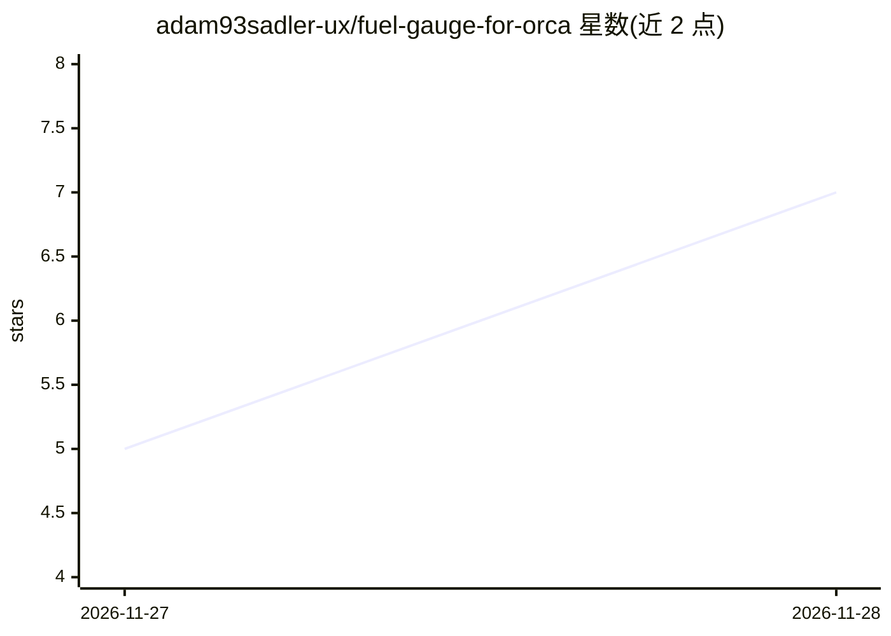

# adam93sadler-ux/fuel-gauge-for-orca

⭐ 7 · TypeScript · MIT · 推送 2026-11-26 · [GitHub](https://github.com/adam93sadler-ux/fuel-gauge-for-orca) · 个人维护

**为 Orca 用户跨 45 个 agent 提供商跟踪用量并路由任务的插件**

由状态栏插件与 agent 技能两部分组成：插件读取各提供商的用量额度与重置时间并写入本地快照；技能读取快照，比较用量窗口、消耗速率与重置时间，帮助编排型 agent 在同一模型档位上选择仍有余量的提供商执行任务，无可用量时将选项呈给用户再决定降级或付费。要求 Orca 1.4.248+ 与 Bash、Python 3。快照写入本地，认证走本地登录；部分用量接口为非官方端点，可能随提供商变更而失效。

## 筛选速览

| 维度 | 判定 | 备注 |
|---|---|---|
| AI 角色 | `ai-ecosystem` | LLM/agent 周边工具 |
| 许可风险 | `permissive` | MIT |
| 部署形态 | `None` |  |
| 模型依赖 | — | README 未给出锁定关系 |
| 硬件要求 | — | 无带数字的原话,不猜 |
| 安装摩擦 | `low` | 无编译、无系统依赖或容器化 |
| 成熟度 | — | 结构信号不足 |

## 能力要点

- 检测本地已安装的 45 个 Orca 可启动 agent 并读取其用量
- 技能按用量窗口、消耗速率与重置时间做同档位路由
- 快照原子写入本地 JSON，含余额与错误/最后成功时间戳
- 可按 JSON 配置忽略指定提供商，轮询间隔 1–1440 分钟可调

## 适用场景

- 多订阅用户在额度耗尽前把任务路由到仍有余量的提供商
- 把按量计费的 API 留作最后兜底，优先消耗订阅额度
- 在状态栏集中查看各 agent 提供商的用量与重置时间

## 场景标签

`模型网关` · 领域:Agent 开发

## 证据(README 行号)

> L3: Fuel Gauge pairs an Orca status-bar plugin with an agent skill. The plugin reads provider allowances and reset times
> L9: The orchestrator chooses the tier. The skill compares usage windows, recent burn rate and upcoming resets across eli

## 星数曲线

2026-11-27 5 → 2026-11-28 7（+2）

---
*卡片 v1 · prompt 1.4 · 生成 2026-11-27 · 置信度 high · 依据 README sha `47290801002d` · [字段定义](../../DATASET.md)*
