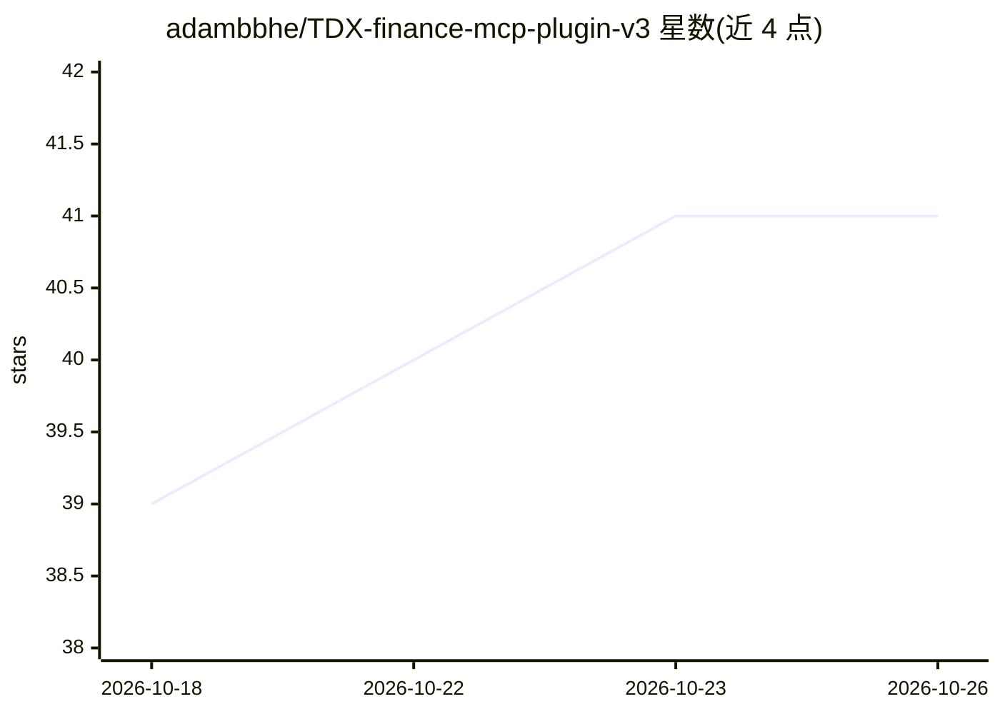

# adambbhe/TDX-finance-mcp-plugin-v3

⭐ 41 · JavaScript · MIT · 推送 2026-10-24 · [GitHub](https://github.com/adambbhe/TDX-finance-mcp-plugin-v3) · 个人维护 · 中文 README

**为 OpenClaw 提供通达信 A 股金融数据的 MCP 插件**

面向 OpenClaw 平台的 MCP 插件，封装通达信（TDX）A 股数据接口：6 个联网工具（统一 F10 基本面接口、实时行情、K线、代码/名称 RAG 检索、自然语言智能选股、指标查询）调用 2 个外部 API 服务器，另含 2 个本地固化清单工具（100 个主要指数、503 个行业板块，无网络请求），并内置 48 个投资分析技能。需 Node.js ≥22.16.0 与通达信官方 API Token，通过 git clone 安装，Token 经 config.json 或环境变量注入。README 附基于真实接口的实测报告与故障排查。

## 筛选速览

| 维度 | 判定 | 备注 |
|---|---|---|
| AI 角色 | `ai-ecosystem` | LLM/agent 周边工具 |
| 许可风险 | `permissive` | MIT |
| 部署形态 | `None` |  |
| 模型依赖 | — | README 未给出锁定关系 |
| 硬件要求 | — | 无带数字的原话,不猜 |
| 安装摩擦 | `low` | 无编译、无系统依赖或容器化 |
| 成熟度 | — | 结构信号不足 |

## 能力要点

- 8 个工具覆盖 F10 基本面、实时行情、K线、智能选股、指标与代码检索
- 48 个内置投资分析技能随插件自动加载
- 2 个本地固化清单工具零网络请求直返
- v3 清理了硬编码 Token 与失效的问达平台工具

## 适用场景

- 在 OpenClaw agent 中查询 A 股行情、K线与 F10 基本面数据
- 通过自然语言智能选股与金融指标查询
- 获取主要指数与行业板块目录以支撑投资分析技能

## 场景标签

`金融量化` · 领域:学习与行业

## 证据(README 行号)

> L15: **TDX Finance MCP Plugin v3** 是一个为 OpenClaw 平台设计的金融数据服务插件，提供通达信（TDX）A 股金融数据接口的统一访问能力。
> L17: 本插件封装了 **8 个经过验证的核心工具**（6 个联网数据工具 + 2 个本地固化清单工具），并内置 **48 个专业投资分析技能**，覆盖 A 股实时行情、K线、F10 基本面、智能选股、指标筛选、代码检索、主要指数与行业板

## 星数曲线

2026-10-18 39 → 2026-10-26 41（+2）

---
*卡片 v1 · prompt 1.4 · 生成 2026-10-25 · 置信度 high · 依据 README sha `eeb5e3d6e2ff` · [字段定义](../../DATASET.md)*
