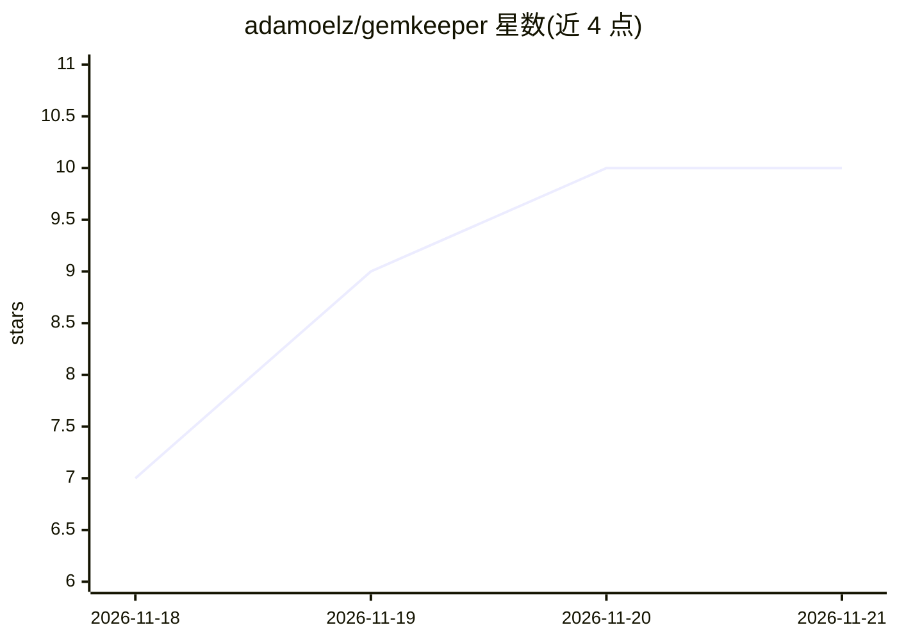

# adamoelz/gemkeeper

⭐ 10 · Shell · MIT · 推送 2026-11-17 · [GitHub](https://github.com/adamoelz/gemkeeper) · 个人维护

**为 Claude Code 会话保存关键上下文的分类账插件**

作为 Claude Code 插件运行：维护一个 `.gemkeeper/ledger.md` 分类账，按 Mission/Rules/Decisions/Dead ends/Facts/Now 六节持续记录任务关键上下文，通过 SessionStart/UserPromptSubmit/PreCompact 三个 hook 在 /clear、自动压缩或新会话时自动重新注入。纯 bash 实现，无依赖、无网络请求。提供完整插件、仅 skill、手动 git clone 三种安装方式；基准测试在单一合成场景下进行，作者声明了结果局限。

## 筛选速览

| 维度 | 判定 | 备注 |
|---|---|---|
| AI 角色 | `ai-ecosystem` | LLM/agent 周边工具 |
| 许可风险 | `permissive` | MIT |
| 部署形态 | `library` | 以包/库形式分发 |
| 模型依赖 | — | README 未给出锁定关系 |
| 硬件要求 | — | 无带数字的原话,不猜 |
| 安装摩擦 | `low` | 无编译、无系统依赖或容器化 |
| 成熟度 | — | 结构信号不足 |

## 能力要点

- 六节结构分类账（Mission/Rules/Decisions/Dead ends/Facts/Now），持续更新
- 三个 hook：会话重启自动注入、消息中的 gem 检查、压缩时排除已记录内容
- 每约 6 个 prompt 做一次 checkpoint，上下文超 ~100k token 时提示 sweep
- 纯 bash，无依赖、无网络、无遥测，可配置阈值

## 适用场景

- 长时间开发会话中 /clear 或压缩后保持任务上下文不丢失
- 跨多个会话延续项目决策、已失败的尝试和环境坑点
- 团队通过提交 ledger 共享任务上下文

## 场景标签

`编码 Agent` `Agent 记忆` · 领域:Agent 开发

## 证据(README 行号)

> L15:  Claude Code plugin
> L47: gemkeeper keeps one short file, `.gemkeeper/ledger.md`, that Claude updates **as things happen**:
> L71: - **Skill `gems`.** Teaches Claude what counts as a gem, the format, and four modes: capture, sweep, resume, close.

## 星数曲线

2026-11-18 7 → 2026-11-21 10（+3）

---
*卡片 v1 · prompt 1.4 · 生成 2026-11-20 · 置信度 high · 依据 README sha `22e4e15e1d03` · [字段定义](../../DATASET.md)*
