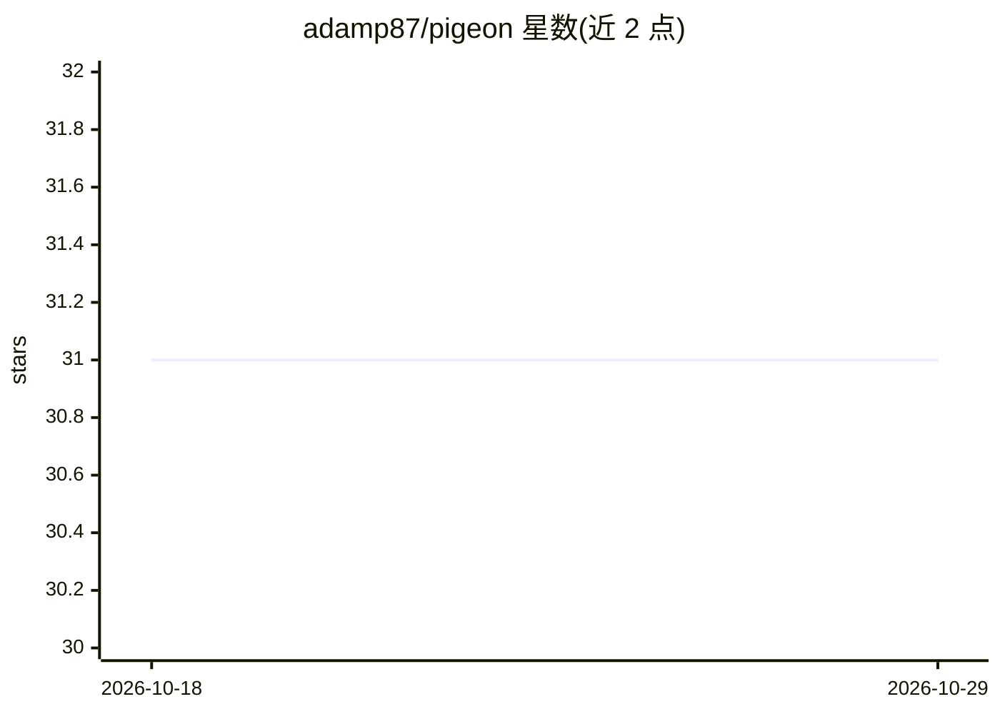

# adamp87/pigeon

⭐ 31 · Python · 推送 2026-09-08 · [GitHub](https://github.com/adamp87/pigeon) · 个人维护

**边缘端实时鸽子检测与驱赶的计算机视觉系统**

运行在树莓派 5 或 PC 上的边缘视觉流水线：第一阶段用 YOLO26/SSD MobileDet/YOLOv8/YOLOv7 检测画面中的鸟类，第二阶段裁剪目标并用 iNaturalist 预训练的 MobileNetV2 做细粒度分类以识别鸽子。后端支持 LiteRT（CPU）与 Coral Edge TPU（pycoral，含双 TPU 分配检测/分类到不同 TPU）。输入支持视频文件、图像目录、摄像头与 RTSP 流，通过 CLI 运行并提供 Docker Compose 环境与预训练模型下载脚本。限制：pycoral 仅支持 Python 3.9 且 NumPy<2.0。

## 筛选速览

| 维度 | 判定 | 备注 |
|---|---|---|
| AI 角色 | `ai-native` | 本体是模型或模型工具 |
| 许可风险 | `none` | — |
| 部署形态 | `self-host` | docker 或自建部署 |
| 模型依赖 | — | README 未给出锁定关系 |
| 硬件要求 | — | 无带数字的原话,不猜 |
| 安装摩擦 | `low` | 无编译、无系统依赖或容器化 |
| 成熟度 | — | 结构信号不足 |

## 能力要点

- 两阶段流水线：通用鸟类检测 + MobileNetV2 鸽子细粒度分类
- 支持 LiteRT CPU 与 Coral Edge TPU 后端，双 TPU 分别跑检测与分类
- 输入支持视频/图像目录/摄像头/RTSP 流，CLI 带延迟基准测试
- 提供 Docker Compose 双环境（Python 3.12 LiteRT / Python 3.9 PyCoral）与模型下载脚本

## 适用场景

- 在树莓派上实时监控摄像头流并识别鸽子
- 用双 Coral TPU 加速边缘检测分类流水线
- 基于 RTSP 摄像头做实时鸟类检测并输出标注视频

## 场景标签

`目标检测` · 领域:感知与多模态

## 证据(README 行号)

> L3: An automated edge-vision system designed to detect and repel pigeons in real time. It supports both **Raspberry Pi 5
> L10: 1. **Object Detection**: Detects generic birds in the frame (using YOLO26, SSD MobileDet, YOLOv8, or YOLOv7).
> L11: 2. **Bird Classification**: Crops each detected bird and performs fine-grained classification (using MobileNetV2 pr

## 星数曲线

2026-10-18 31 → 2026-10-29 31（+0）

---
*卡片 v1 · prompt 1.4 · 生成 2026-10-26 · 置信度 high · 依据 README sha `f023db27b766` · [字段定义](../../DATASET.md)*
