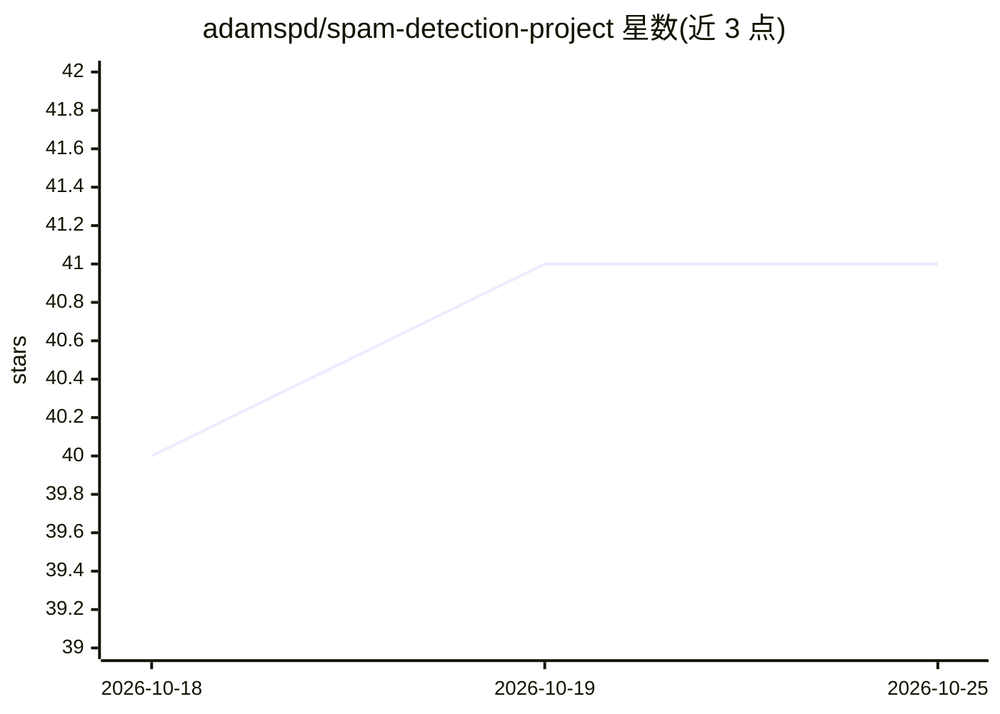

# adamspd/spam-detection-project

⭐ 41 · Python · MIT · 推送 2026-09-27 · [GitHub](https://github.com/adamspd/spam-detection-project) · [官网](https://spam-detection-api.adamspierredavid.com) · 个人维护

**Python 垃圾消息检测库：五种分类器加权投票判定 spam**

面向 Django 或任意 Python 项目的垃圾消息检测包，训练和使用 Naive Bayes、Random Forest、SVM、Logistic Regression、XGBoost 五种分类器。核心机制为 VotingSpamDetector：按各模型准确率分配权重进行加权投票，加权 spam 分数超过 50% 判为垃圾；提供 is_spam() 布尔判定与 score() 结构化分数（README 明确 score 是加权投票份额而非校准概率，仅 32 个可能取值）。训练需自备三列 CSV 数据，运行前需下载 NLTK 数据（wordnet/stopwords）。README 记录 trainer.py 直接运行可能出现 module not found 错误的已知问题。

## 筛选速览

| 维度 | 判定 | 备注 |
|---|---|---|
| AI 角色 | `ai-native` | 本体是模型或模型工具 |
| 许可风险 | `permissive` | MIT |
| 部署形态 | `library` | 以包/库形式分发 |
| 模型依赖 | — | README 未给出锁定关系 |
| 硬件要求 | — | 无带数字的原话,不猜 |
| 安装摩擦 | `low` | 无编译、无系统依赖或容器化 |
| 成熟度 | — | 结构信号不足 |

## 能力要点

- 五种分类器（NB/RF/SVM/LR/XGB）按准确率加权投票的集成判定
- score() 返回结构化置信分数，并说明其为投票份额而非概率
- 模型训练脚本读取三列 CSV 并保存为 .joblib 文件
- 依赖 scikit-learn/nltk/pandas/numpy/joblib/xgboost，需下载 NLTK 数据

## 适用场景

- 在 Django 站点或 Python 项目中过滤用户提交的垃圾消息
- 按置信分数自动分拣高置信垃圾、低置信转人工审核
- 用自有数据重新训练五类分类器做垃圾消息检测

## 场景标签

 · 领域:文本分类/垃圾消息过滤

## 证据(README 行号)

> L13: Spam-Detector-AI is a Python package for detecting and filtering spam messages using Machine Learning models. The
> L218: Given that no single model achieved perfect accuracy, I have decided to implement a voting classifier.

## 星数曲线

2026-10-18 40 → 2026-10-25 41（+1）

---
*卡片 v1 · prompt 1.4 · 生成 2026-10-25 · 置信度 high · 依据 README sha `eeac8c7a7074` · [字段定义](../../DATASET.md)*
