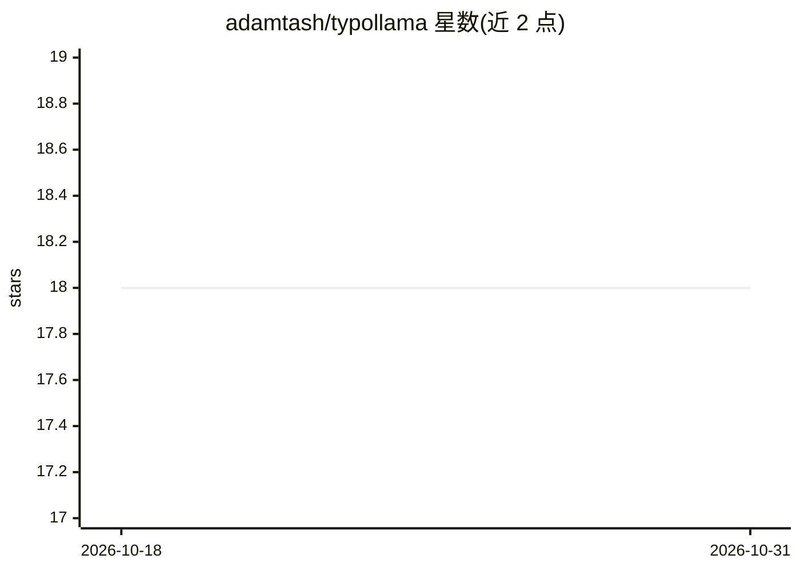

# adamtash/typollama

⭐ 18 · JavaScript · MIT · 推送 2026-10-04 · [GitHub](https://github.com/adamtash/typollama) · [官网](https://chrome.google.com/webstore/detail/Typollama–AI-Spell-Check-%26-Text-Processing/bpfbfpkchkmgladnfmgmhapainhcokel) · 个人维护

**在网页文本框中就地润色的 Chrome 扩展，支持本地与云端模型**

Chrome 浏览器扩展：在任意文本框中选中文本或定位光标后，通过右键菜单或快捷键调用 AI 进行拼写检查、校对改写或自定义写作指令，结果就地在页面中替换。提供商采用各自的请求格式，支持 OpenAI、Anthropic、Gemini、DeepSeek、Mistral、Perplexity Sonar、xAI、Cohere 等 API，Groq/Together/OpenRouter 等兼容端点，以及 Ollama、LM Studio 本地服务与 Chrome 内置 AI。无账户与分析，API 密钥 AES-GCM 加密存储。通过开发者模式加载源码安装。

## 筛选速览

| 维度 | 判定 | 备注 |
|---|---|---|
| AI 角色 | `ai-native` | 本体是模型或模型工具 |
| 许可风险 | `permissive` | MIT |
| 部署形态 | `None` |  |
| 模型依赖 | local-ok | 支持本地模型 |
| 硬件要求 | — | 无带数字的原话,不猜 |
| 安装摩擦 | `low` | 无编译、无系统依赖或容器化 |
| 成熟度 | — | 结构信号不足 |

## 能力要点

- 拼写检查/校对改写/自定义提示三种就地文本工具
- 支持托管 API、OpenAI 兼容端点与 Ollama/LM Studio 本地服务
- API 密钥 AES-GCM 加密后本地存储，无开发者运营后端
- 对阻止程序化编辑的富文本站点改为复制结果供手动粘贴

## 适用场景

- 在网页写作时快速纠正拼写与标点
- 用本地 Ollama/LM Studio 完成校对以避免文本外发
- 定义自定义编辑指令处理重复性文本改写任务

## 场景标签

`AI 写作` · 领域:内容生成

## 证据(README 行号)

> L3: Typollama is a privacy-conscious Chrome extension that improves text directly where you write. Select text—or place 
> L11: - **Spellcheck** fixes spelling and punctuation while preserving wording and formatting.
> L26: |Hosted APIs|OpenAI, Anthropic, Google Gemini, DeepSeek, Mistral AI, Perplexity Sonar, xAI Grok, Cohere|

## 星数曲线

2026-10-18 18 → 2026-10-31 18（+0）

---
*卡片 v1 · prompt 1.4 · 生成 2026-10-29 · 置信度 high · 依据 README sha `819340179def` · [字段定义](../../DATASET.md)*
