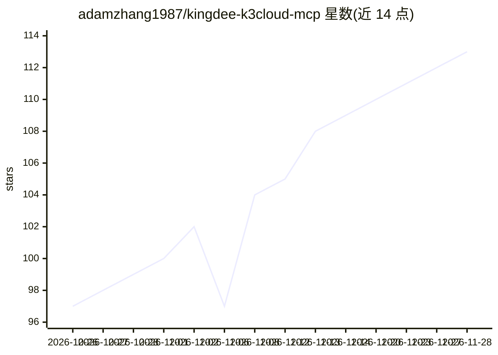

# adamzhang1987/kingdee-k3cloud-mcp

⭐ 113 · Python · Apache-2.0 · 推送 2026-11-23 · [GitHub](https://github.com/adamzhang1987/kingdee-k3cloud-mcp) · [官网](https://adamzhang1987.github.io/kingdee-k3cloud-mcp/) · 个人维护 · 中文 README

**让 AI 助手通过 MCP 自然语言操作金蝶云星空 ERP**

面向金蝶云星空 ERP 的 MCP Server，基于 FastMCP 将金蝶官方 Python SDK 封装为 15 个 MCP 工具，覆盖单据查询、自动翻页、流式导出、新增、提交、审核、下推等操作。通过单一 form_id 参数支持任意表单，提供只读模式、启动时凭据校验、认证失败诊断、stdio/SSE/streamable-http 多种传输。需 Python 3.10+ 及 5 个金蝶第三方授权环境变量；数据权限完全依赖星空侧集成用户的配置，服务本身不实现权限模型。

## 筛选速览

| 维度 | 判定 | 备注 |
|---|---|---|
| AI 角色 | `ai-ecosystem` | LLM/agent 周边工具 |
| 许可风险 | `permissive` | Apache-2.0 |
| 部署形态 | `library` | 以包/库形式分发 |
| 模型依赖 | — | README 未给出锁定关系 |
| 硬件要求 | — | 无带数字的原话,不猜 |
| 安装摩擦 | `low` | 无编译、无系统依赖或容器化 |
| 成熟度 | — | 结构信号不足 |

## 能力要点

- 15 个 MCP 工具覆盖查询、导出与单据生命周期操作
- 只读模式物理移除写入工具，配合 Bearer Token 鉴权
- query_bill_all/query_bill_to_file/query_bill_range 处理万行级查询导出
- 支持 stdio、SSE、streamable-http 三种传输协议

## 适用场景

- 在 Claude Desktop/Cursor 里用自然语言查金蝶销售订单和库存
- 把万行级销售出库单导出为 CSV/NDJSON
- 生产环境以只读模式接入 AI Agent 查询 ERP
- 通过 Openclaw 在微信/Telegram 里查库存和单据

## 场景标签

`工作流自动化` · 领域:效率与自动化

## 证据(README 行号)

> L13: 金蝶MCP Server（Kingdee K3Cloud MCP）面向金蝶云星空 ERP，让 AI 助手（Claude Desktop、Claude Code、Cursor、Windsurf、Cline、Continue、Cher
> L336: 本项目使用官方金蝶 Python SDK（kingdee-cdp-webapi-sdk）与 K3Cloud API 通信，并通过 FastMCP 将其封装为标准 MCP 工具。

## 星数曲线

2026-10-26 97 → 2026-11-28 113（+16）

---
*卡片 v1 · prompt 1.4 · 生成 2026-11-28 · 置信度 high · 依据 README sha `b26b2ee47e17` · [字段定义](../../DATASET.md)*
