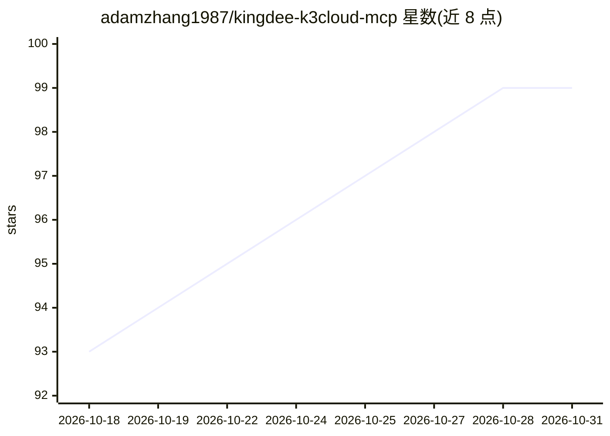

# adamzhang1987/kingdee-k3cloud-mcp

⭐ 99 · Python · Apache-2.0 · 推送 2026-10-26 · [GitHub](https://github.com/adamzhang1987/kingdee-k3cloud-mcp) · [官网](https://adamzhang1987.github.io/kingdee-k3cloud-mcp/) · 个人维护 · 中文 README

**让 AI 助手通过 MCP 自然语言操作金蝶云星空 ERP 的服务器**

面向金蝶云星空 ERP 的 MCP Server，用 Python 编写、基于 FastMCP，将金蝶 K3Cloud Web API 封装为 15 个标准 MCP 工具，供 Claude Desktop、Claude Code、Cursor、Windsurf、Cline、Continue、Cherry Studio、Openclaw 等任意 MCP 客户端以自然语言查询与操作 ERP（查询、导出、新增、提交、审核、下推等）。支持只读模式、stdio/SSE/streamable-http 传输、启动凭据自检，并提供自动翻页、流式落盘、日期分片等大数据量查询原语。以 PyPI 标准包分发，pip install 或 uvx 直接运行；数据权限由金蝶侧集成用户的权限配置决定。

## 筛选速览

| 维度 | 判定 | 备注 |
|---|---|---|
| AI 角色 | `ai-ecosystem` | LLM/agent 周边工具 |
| 许可风险 | `permissive` | Apache-2.0 |
| 部署形态 | `library` | 以包/库形式分发 |
| 模型依赖 | — | README 未给出锁定关系 |
| 硬件要求 | — | 无带数字的原话,不猜 |
| 安装摩擦 | `low` | 无编译、无系统依赖或容器化 |
| 成熟度 | — | 结构信号不足 |

## 能力要点

- 15 个 MCP 工具覆盖查询/导出/写入/审核/下推，单一 form_id 支持任意表单
- 只读模式物理禁用写入工具；多传输协议（stdio/SSE/streamable-http）
- 自动翻页、流式落盘、日期分片三种大数据量查询原语
- 启动即校验凭据并返回可操作修复指引，基于 Pydantic 做入参校验

## 适用场景

- 在 Claude/Cursor 等 MCP 客户端里用自然语言查库存、查销售订单
- 把万行级单据数据导出为 csv/ndjson
- 通过 Openclaw 等平台在微信/Telegram 中查询金蝶单据
- 以只读模式在生产环境部署 ERP 查询 Agent

## 场景标签

 · 领域:企业软件集成/AI 工具

## 证据(README 行号)

> L13: 金蝶MCP Server（Kingdee K3Cloud MCP）面向金蝶云星空 ERP，让 AI 助手（Claude Desktop、Claude Code、Cursor、Windsurf、Cline、Continue、Cher
> L30: - **15 个 MCP 工具**：覆盖查询、大数据量导出、新增、提交、审核、反审核、删除、下推等核心操作
> L311: 本项目使用官方金蝶 Python SDK（kingdee-cdp-webapi-sdk）与 K3Cloud API 通信，并通过 FastMCP 将其封装为标准 MCP 工具。

## 星数曲线

2026-10-18 93 → 2026-10-31 99（+6）

---
*卡片 v1 · prompt 1.4 · 生成 2026-10-23 · 置信度 high · 依据 README sha `aab3b9c1b722` · [字段定义](../../DATASET.md)*
