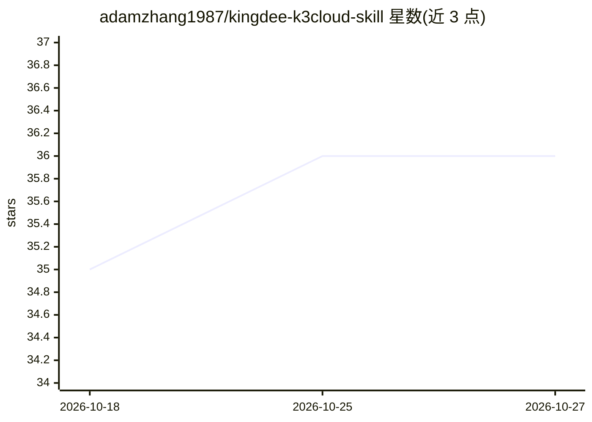

# adamzhang1987/kingdee-k3cloud-skill

⭐ 36 · Makefile · Apache-2.0 · 推送 2026-09-24 · [GitHub](https://github.com/adamzhang1987/kingdee-k3cloud-skill) · [官网](https://adamzhang1987.github.io/kingdee-k3cloud-skill/) · 个人维护 · 中文 README

**为 Claude Code 等 Agent 注入金蝶云星空 ERP 查询知识的 Skill**

面向支持 Skill 机制的 AI Agent（Claude Code、Openclaw 等）的金蝶云星空 ERP 知识包：以 SKILL.md 决策树与 references 文档形式提供已验证的表单 ID、字段名与工作流（经营日报、客户查询、单据操作、错误排查），供 Agent 自动查阅以避免字段名错误导致的 500 错误。需配合金蝶 MCP Server 使用，但可分别部署；采用渐进式披露分层加载控制 token。安装方式为下载 .skill 文件放入 skills 目录或从源码打包。

## 筛选速览

| 维度 | 判定 | 备注 |
|---|---|---|
| AI 角色 | `ai-knowledge` | 知识聚合/清单类 |
| 许可风险 | `permissive` | Apache-2.0 |
| 部署形态 | `None` |  |
| 模型依赖 | — | README 未给出锁定关系 |
| 硬件要求 | — | 无带数字的原话,不猜 |
| 安装摩擦 | `low` | 无编译、无系统依赖或容器化 |
| 成熟度 | — | 结构信号不足 |

## 能力要点

- 内置各模块已验证字段名与错误排查知识
- SKILL.md 决策树 + references 分层按需加载（Progressive Disclosure）
- 自定义字段发现指南：用 query_metadata 沉淀二开知识
- 预置经营日报、客户查询、销售/库存分析等查询工作流

## 适用场景

- 让 Claude Code 用自然语言查询金蝶星空的订单、库存、客户数据
- 减少 Agent 猜字段名导致的 500 错误与试错往返
- 封装本企业自定义字段（F_ 前缀）知识供 Agent 复用

## 场景标签

`数据分析` · 领域:效率与自动化

## 证据(README 行号)

> L9: 面向支持 Skill 机制的 AI Agent（Claude Code、Openclaw 等）的金蝶云星空 ERP Skill，把「哪个表单用哪个字段、怎么查最省 token」这类踩坑经验直接注入 Agent，大幅减少字段猜测导致的
> L32: - **Skill（本项目）** = 知识库 + 工作流决策树，让 Agent 自动掌握正确的 API 用法，避免字段名错误

## 星数曲线

2026-10-18 35 → 2026-10-27 36（+1）

---
*卡片 v1 · prompt 1.4 · 生成 2026-10-25 · 置信度 high · 依据 README sha `d03095764900` · [字段定义](../../DATASET.md)*
