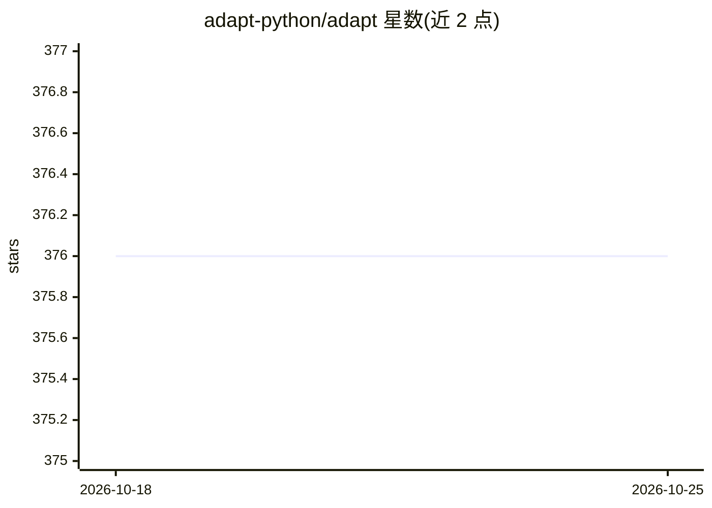

# adapt-python/adapt

⭐ 376 · Python · BSD-2-Clause · 推送 2025-12-02 · [GitHub](https://github.com/adapt-python/adapt) · [官网](https://adapt-python.github.io/adapt/) · 组织维护

**领域自适应/迁移学习算法的 Python 工具箱**

开源 Python 库，提供大量迁移学习与领域自适应算法：特征类（FA/DANN/CORAL/CDAN 等 13 种）、样本加权类（KMM/TrAdaBoost 等 8 种）、参数类（FineTuning/正则迁移等 6 种）。所有对象实现 fit/predict/score，遵循 scikit-learn API 风格，兼容 Tensorflow，面向工业界与研究用户。通过 pip 从 PyPI 安装，依赖 numpy/scipy/tensorflow/scikit-learn 等；README 注明新 Tensorflow 版本可能存在兼容性问题，给出经测试的环境版本（Python 3.8-3.11）。由 Michelin 与 ENS Paris-Saclay 资助，有 arXiv 论文（2107.03049）。

## 筛选速览

| 维度 | 判定 | 备注 |
|---|---|---|
| AI 角色 | `ai-native` | 本体是模型或模型工具 |
| 许可风险 | `permissive` | BSD-2-Clause |
| 部署形态 | `library` | 以包/库形式分发 |
| 模型依赖 | — | README 未给出锁定关系 |
| 硬件要求 | — | 无带数字的原话,不猜 |
| 安装摩擦 | `low` | 无编译、无系统依赖或容器化 |
| 成熟度 | — | 结构信号不足 |

## 能力要点

- 覆盖特征/样本/参数三类迁移的 27 种算法实现
- 所有对象实现 fit/predict/score，与 scikit-learn 使用方式一致
- 支持 scikit-learn 估计器与 Tensorflow 模型两种后端形态
- 提供选择算法的决策流程图与多组示例文档

## 适用场景

- 源域与目标域分布不一致时修正模型（如样本偏差纠正）
- 在少量标注目标数据上做迁移分类/回归
- 复现与对比领域自适应领域论文算法

## 场景标签

 · 领域:机器学习/迁移学习

## 证据(README 行号)

> L10: ADAPT is an open source library providing numerous tools to perform Transfer Learning and Domain Adaptation.
> L12: The purpose of the ADAPT library is to facilitate the access to transfer learning algorithms for a large public, in
> L144: - FA (*Frustratingly Easy Domain Adaptation*) [[paper]](https://arxiv.org/pdf/0907.1815.pdf)

## 星数曲线

2026-10-18 376 → 2026-10-25 376（+0）

---
*卡片 v1 · prompt 1.4 · 生成 2026-10-21 · 置信度 high · 依据 README sha `684a80bc04f7` · [字段定义](../../DATASET.md)*
