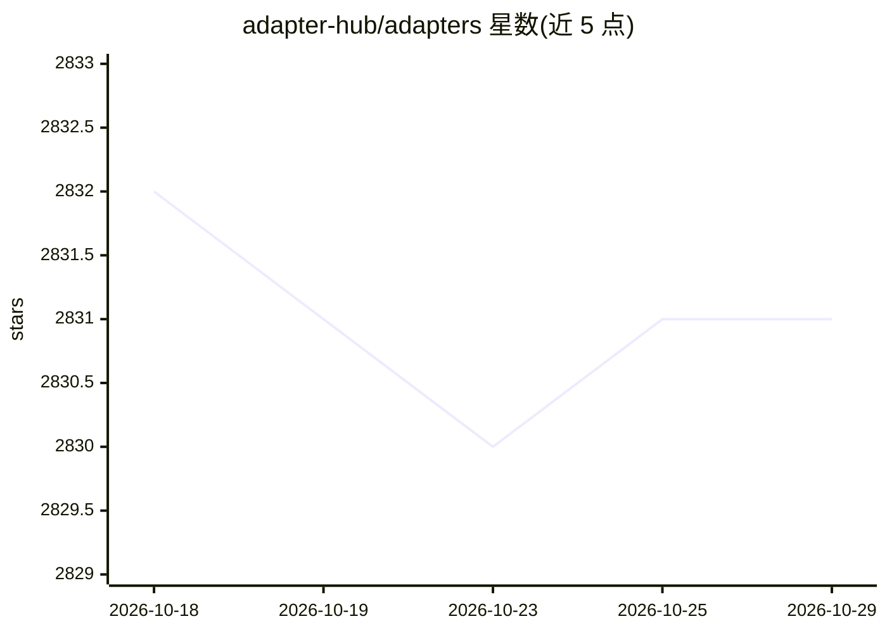

# adapter-hub/adapters

⭐ 2,831 · Python · Apache-2.0 · 推送 2026-04-26 · [GitHub](https://github.com/adapter-hub/adapters) · [官网](https://docs.adapterhub.ml) · 组织维护

**为 NLP 研究者提供的参数高效微调统一库（适配器/LoRA 等）**

HuggingFace Transformers 的附加库，将 10+ 种参数高效微调方法（Bottleneck adapters、LoRA、Prefix Tuning、QLoRA、ReFT 等）集成到 20+ 个 Transformer 模型中，提供统一接口做训练与推理。支持全精度或量化训练、任务算术合并适配器、通过组合块组合多个适配器，训练好的适配器可从 AdapterHub 加载与共享。需 Python 3.9+ 与 PyTorch 2.0+，通过 pip 或源码安装。前身为 adapter-transformers 包，旧适配器兼容。

## 筛选速览

| 维度 | 判定 | 备注 |
|---|---|---|
| AI 角色 | `ai-ecosystem` | LLM/agent 周边工具 |
| 许可风险 | `permissive` | Apache-2.0 |
| 部署形态 | `library` | 以包/库形式分发 |
| 模型依赖 | — | README 未给出锁定关系 |
| 硬件要求 | — | 无带数字的原话,不猜 |
| 安装摩擦 | `low` | 无编译、无系统依赖或容器化 |
| 成熟度 | — | 结构信号不足 |

## 能力要点

- 集成 10+ 适配器方法到 20+ Transformer 模型
- 支持量化训练（Q-LoRA、Q-Bottleneck、Q-PrefixTuning）
- 任务算术合并适配器与组合块多适配器组合
- 从 AdapterHub 加载/分享预训练适配器模块

## 适用场景

- 在有限参数预算下微调 Transformer 模型做 NLP 任务
- 研究并对比不同参数高效微调方法
- 在一个模型内组合或合并多个任务适配器

## 场景标签

`微调` · 领域:训练与推理

## 证据(README 行号)

> L15: _Adapters_ is an add-on library to HuggingFace's Transformers, integrating 10+ adapter methods into 20+ state-of-th
> L17: _Adapters_ provides a unified interface for efficient fine-tuning and modular transfer learning, supporting a myria

## 星数曲线

2026-10-18 2,832 → 2026-10-29 2,831（-1）

---
*卡片 v1 · prompt 1.4 · 生成 2026-10-21 · 置信度 high · 依据 README sha `dbf2d6ad6e1e` · [字段定义](../../DATASET.md)*
