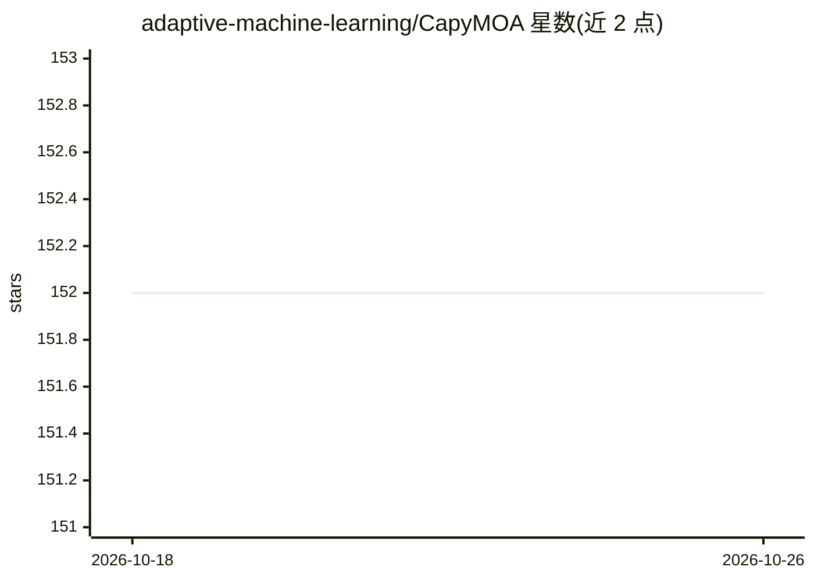

# adaptive-machine-learning/CapyMOA

⭐ 152 · Python · BSD-3-Clause · 推送 2026-10-24 · [GitHub](https://github.com/adaptive-machine-learning/CapyMOA) · [官网](https://capymoa.org/) · 组织维护

**Python 数据流机器学习工具箱：分类/聚类/异常检测/漂移检测**

面向数据流场景的 Python 机器学习工具箱，提供分类、回归、聚类、异常检测、半监督学习、在线持续学习与漂移检测的方法和评估器，内置 Electricity 等数据集与 HoeffdingTree 等算法。深度学习部分（ocl、torch.ann、Batch* 学习器）依赖 PyTorch，以 pip 可选扩展安装，另有 CPU-only PyTorch 方案。由学术团队（含 Albert Bifet 等MOA相关研究者）维护，README 声明版本 1.0.0 前 API 可能变动，提供 Docker 镜像与 Discord 社区。

## 筛选速览

| 维度 | 判定 | 备注 |
|---|---|---|
| AI 角色 | `ai-native` | 本体是模型或模型工具 |
| 许可风险 | `permissive` | BSD-3-Clause |
| 部署形态 | `library` | 以包/库形式分发 |
| 模型依赖 | — | README 未给出锁定关系 |
| 硬件要求 | — | 无带数字的原话,不猜 |
| 安装摩擦 | `low` | 无编译、无系统依赖或容器化 |
| 成熟度 | `idea` | |

## 能力要点

- 覆盖数据流的分类/回归/聚类/异常检测/漂移检测等任务
- 深度学习模块通过 pip install capymoa[torch] 可选安装
- 内置数据集（Electricity、RTG_2abrupt）与可复现的基准测试脚本
- 提供 Docker 镜像与文档、教程

## 适用场景

- 在持续到达的数据流上做在线分类或异常检测
- 研究概念漂移检测与在线持续学习方法
- 用 Python 生态对流式学习算法做评估与基准测试

## 场景标签

 · 领域:机器学习/数据流挖掘

## 证据(README 行号)

> L12: **CapyMOA does efficient machine learning for data streams in Python**. A data stream is
> L14: offline. CapyMOA is a toolbox of methods and evaluators for: classification, regression,
> L15: clustering, anomaly detection, semi-supervised learning, online continual learning, and

## 星数曲线

2026-10-18 152 → 2026-10-26 152（+0）

---
*卡片 v1 · prompt 1.4 · 生成 2026-10-22 · 置信度 high · 依据 README sha `eb8da502a3e2` · [字段定义](../../DATASET.md)*
