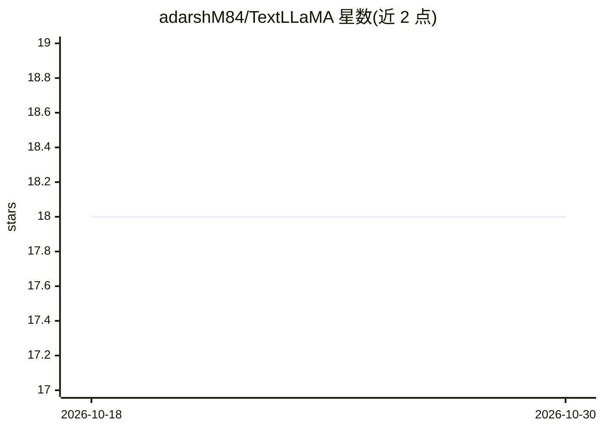

# adarshM84/TextLLaMA

⭐ 18 · HTML · 推送 2026-01-14 · [GitHub](https://github.com/adarshM84/TextLLaMA) · 个人维护

**浏览器写作辅助扩展：本地 Ollama 驱动的语法纠正与翻译**

Chrome 扩展，面向需要写作辅助的普通用户：选中文本后经右键菜单进行语法纠正、词语解释、多语言翻译（含阿拉伯语）、邮件撰写与自动回复、当前页面摘要。文本可直接注入编辑器。运行依赖本地 Ollama 开源模型，宣称数据不离开设备。通过下载链接安装扩展，README 未列出 Ollama 之外的安装命令或支持的模型清单细节。

## 筛选速览

| 维度 | 判定 | 备注 |
|---|---|---|
| AI 角色 | `ai-native` | 本体是模型或模型工具 |
| 许可风险 | `none` | — |
| 部署形态 | `None` |  |
| 模型依赖 | local-ok | 支持本地模型 |
| 硬件要求 | — | 无带数字的原话,不猜 |
| 安装摩擦 | `low` | 无编译、无系统依赖或容器化 |
| 成熟度 | — | 结构信号不足 |

## 能力要点

- 选中文本右键菜单触发语法纠正/解释/翻译
- Gmail 与 Outlook 中撰写邮件并生成自动回复
- 当前页面摘要与解释，PDF 交互翻译
- 本地 Ollama 运行，宣称数据不离设备

## 适用场景

- 浏览网页时纠正选中英文的语法与拼写
- 把外语文本翻译成多语言（含阿拉伯语）
- 在 Gmail/Outlook 里快速撰写和回复邮件
- 让 AI 解释难懂的网页或 PDF 内容

## 场景标签

`AI 写作` `AI 助手` · 领域:对话与助手

## 证据(README 行号)

> L13: ✨ **Explain** content in a simple and easy-to-understand way.
> L27: - 🔒 **Privacy First** – Runs fully offline using Ollama; your data never leaves your device.

## 星数曲线

2026-10-18 18 → 2026-10-30 18（+0）

---
*卡片 v1 · prompt 1.4 · 生成 2026-10-29 · 置信度 high · 依据 README sha `adfc0614a83a` · [字段定义](../../DATASET.md)*
