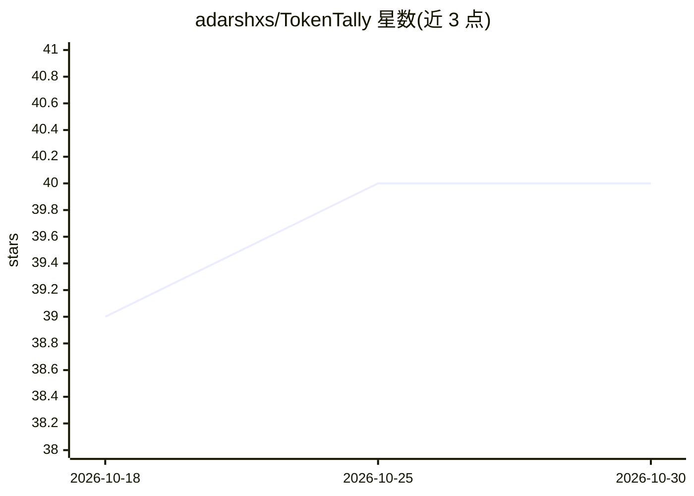

# adarshxs/TokenTally

⭐ 40 · Python · MIT · 推送 2025-11-09 · [GitHub](https://github.com/adarshxs/TokenTally) · [官网](https://tokentally.streamlit.app) · 个人维护

**为开发者估算 LLM 训练/推理的 GPU 显存需求与每千 token 成本**

面向 LLM 部署决策的计算工具：基于公开论文与博客的简化公式，估算推理（Model_size×1.2）与训练场景下模型/梯度/优化器/激活/通信等各部分 GPU 显存占用；输入 FLOPs、GPU 数量、每小时成本、显存带宽等参数，分别按算力受限与显存带宽受限两条路径计算每 1,000 token 的成本。README 声明为朴素估算方法，部分逻辑与数据在征集社区贡献实现；另附常见 LLM 推理框架对照表。未给出本产品的安装或运行命令。

## 筛选速览

| 维度 | 判定 | 备注 |
|---|---|---|
| AI 角色 | `ai-ecosystem` | LLM/agent 周边工具 |
| 许可风险 | `permissive` | MIT |
| 部署形态 | `None` |  |
| 模型依赖 | — | README 未给出锁定关系 |
| 硬件要求 | — | 无带数字的原话,不猜 |
| 安装摩擦 | `low` | 无编译、无系统依赖或容器化 |
| 成熟度 | — | 结构信号不足 |

## 能力要点

- 按论文公式估算推理最低显存（Model_size×1.2）与训练各显存分量
- 计算算力受限/显存带宽受限两种情形下每千 token 成本
- 覆盖 ZeRO 阶段、张量/流水线并行、激活检查点等配置参数
- 附 8 个常见 LLM 推理框架的对照表

## 适用场景

- 部署前估算某模型推理或微调所需的最少 GPU 显存
- 比较不同 GPU 云平台配置下每千 token 的成本
- 了解主流 LLM 推理框架的部署选项

## 场景标签

 · 领域:LLM 部署/成本估算工具

## 证据(README 行号)

> L7: 🎯The goal is to be able to calculate the **minimum GPU requirements** for **Training**(Fine Tuning and Continued Pre
> L13: The current formula to calculate the minimum size for inference and training is from the findings in Reducing Activ

## 星数曲线

2026-10-18 39 → 2026-10-30 40（+1）

---
*卡片 v1 · prompt 1.4 · 生成 2026-10-25 · 置信度 mid · 依据 README sha `9a0fe57d9265` · [字段定义](../../DATASET.md)*
