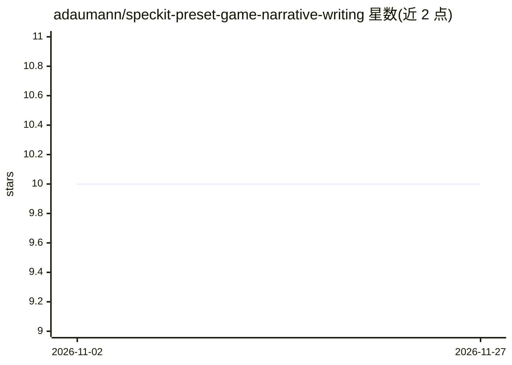

# adaumann/speckit-preset-game-narrative-writing

⭐ 10 · HTML · 推送 2026-07-16 · [GitHub](https://github.com/adaumann/speckit-preset-game-narrative-writing) · 个人维护

**为游戏叙事写作提供 Spec Kit 规范驱动开发预设**

Spec Kit 的一个预设包，将规范驱动开发流程适配到游戏叙事与互动叙事创作：feature 映射为故事机制、spec 映射为叙事简报、plan 映射为故事地图、task 映射为对话与场景写作任务。支持分支叙事、玩家能动性系统、状态机与交互式对话树，覆盖选择式 IF、视觉小说与分支对话等形式，支持多结局、多视角与 Tier 1 机制钩子，作者以通用可移植格式撰写（Twine/Sugarcube .twee 或 Ink .ink）。需 Spec Kit >= 0.5.0，通过 specify CLI 安装。

## 筛选速览

| 维度 | 判定 | 备注 |
|---|---|---|
| AI 角色 | `ai-ecosystem` | LLM/agent 周边工具 |
| 许可风险 | `none` | — |
| 部署形态 | `None` |  |
| 模型依赖 | — | README 未给出锁定关系 |
| 硬件要求 | — | 无带数字的原话,不猜 |
| 安装摩擦 | `low` | 无编译、无系统依赖或容器化 |
| 成熟度 | — | 结构信号不足 |

## 能力要点

- 将规范驱动开发工作流映射到叙事创作（机制/简报/故事地图/写作任务）
- 支持 .twee（Twine/Sugarcube）与 .ink（Ink）可移植格式
- 覆盖 choice-IF、视觉小说、分支对话等形式
- 支持多结局、多视角与机制钩子，附 8 万字以上分支示例项目

## 适用场景

- 游戏预制作阶段编写分支叙事与对话树
- 视觉小说或互动小说项目的结构化规范管理
- 多结局多视角叙事的规范化写作流程

## 场景标签

`AI 写作` · 领域:内容生成

## 证据(README 行号)

> L3: A Spec Kit preset for game narrative design and interactive storytelling.
> L5: It adapts the Spec-Driven Development workflow for game narratives: features become story mechanics, specs become na

## 星数曲线

2026-11-02 10 → 2026-11-27 10（+0）

---
*卡片 v1 · prompt 1.4 · 生成 2026-11-20 · 置信度 mid · 依据 README sha `8fe25b530261` · [字段定义](../../DATASET.md)*
