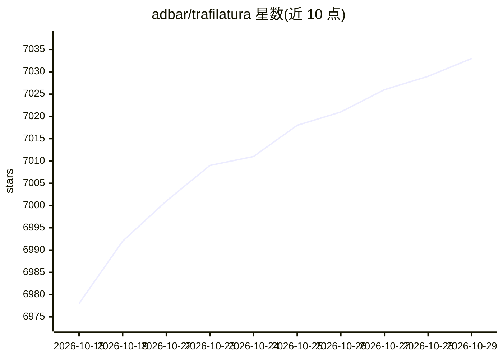

# adbar/trafilatura

⭐ 7,033 · Python · Apache-2.0 · 推送 2026-10-28 · [GitHub](https://github.com/adbar/trafilatura) · [官网](https://trafilatura.readthedocs.io) · 个人维护

**Python/命令行网页正文与元数据抽取工具**

Python 包兼命令行工具，将原始 HTML 转为结构化数据：支持网页爬取（sitemap/feeds）、下载队列处理、正文与元数据（标题/作者/日期等）抽取，规则式抽取器辅以 jusText 与 readability-lxml 作为回退，可输出 TXT/Markdown/CSV/JSON/XML 等格式。无需数据库，面向需要批量获取网络文本语料的开发者和研究者，被 HuggingFace、NVIDIA 等项目使用，源于语言学/NLP 博士项目。

## 筛选速览

| 维度 | 判定 | 备注 |
|---|---|---|
| AI 角色 | `ai-ecosystem` | LLM/agent 周边工具 |
| 许可风险 | `permissive` | Apache-2.0 |
| 部署形态 | `None` |  |
| 模型依赖 | — | README 未给出锁定关系 |
| 硬件要求 | — | 无带数字的原话,不猜 |
| 安装摩擦 | `low` | 无编译、无系统依赖或容器化 |
| 成熟度 | — | 结构信号不足 |

## 能力要点

- 内置爬取与 URL 管理过滤去重
- 规则式正文抽取器，jusText/readability-lxml 回退
- 多种输出格式（TXT/MD/CSV/JSON/HTML/XML/XML-TEI）
- 支持 Python、命令行与 R 三种使用方式

## 适用场景

- 批量抓取网页构建文本语料库
- 为 RAG/LLM 数据流程准备干净的正文与元数据
- 从新闻源或 sitemap 提取结构化内容

## 场景标签

`网页抓取` · 领域:效率与自动化

## 证据(README 行号)

> L23: Trafilatura is a comprehensive **Python package and command-line tool**
> L37: Trafilatura is widely used
> L39: including by HuggingFace, IBM, Microsoft Research, NVIDIA, the Allen Institute for AI, Stanford, and the Internet A

## 星数曲线

2026-10-18 6,978 → 2026-10-29 7,033（+55）

---
*卡片 v1 · prompt 1.4 · 生成 2026-10-21 · 置信度 mid · 依据 README sha `2fa1b5897ad4` · [字段定义](../../DATASET.md)*
