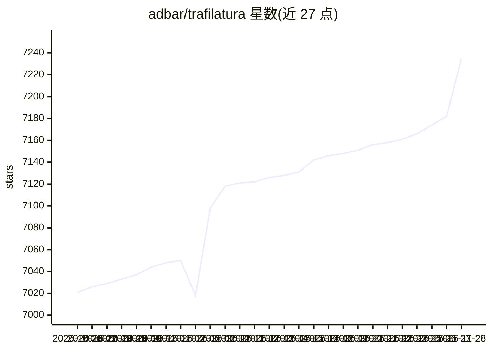

# adbar/trafilatura

⭐ 7,235 · Python · Apache-2.0 · 推送 2026-11-27 · [GitHub](https://github.com/adbar/trafilatura) · [官网](https://trafilatura.readthedocs.io) · 个人维护

**面向研究者的网页正文抓取与结构化提取 Python 工具**

Python 包与命令行工具，覆盖网页发现、爬取、下载、抓取与正文/元数据提取：支持 sitemap 与 ATOM/RSS/JSON feed、URL 过滤去重、并行处理在线与离线 HTML 输入；自带规则提取器并以 readability 与 jusText 作回退，可输出 TXT、Markdown、CSV、JSON、HTML、XML、XML-TEI，无需数据库。始于语言学与 NLP 交叉的博士项目，最初为柏林-勃兰登堡科学院的文本数据库建设而开发。

## 筛选速览

| 维度 | 判定 | 备注 |
|---|---|---|
| AI 角色 | `ai-enhanced` | 去掉 AI 部分产品仍成立 |
| 许可风险 | `permissive` | Apache-2.0 |
| 部署形态 | `None` |  |
| 模型依赖 | — | README 未给出锁定关系 |
| 硬件要求 | — | 无带数字的原话,不猜 |
| 安装摩擦 | `low` | 无编译、无系统依赖或容器化 |
| 成熟度 | — | 结构信号不足 |

## 能力要点

- 规则正文提取器，内置 readability 与 jusText 回退
- 支持 sitemap/feed 发现、URL 过滤去重与并行处理
- 提取标题、作者、日期、分类标签等元数据
- 输出 TXT/MD/CSV/JSON/HTML/XML/XML-TEI 多格式

## 适用场景

- 构建用于 NLP 研究的网页文本语料库
- 批量抓取新闻站点正文与元数据
- 将 HTML 页面转换为 Markdown 或纯文本
- 为下游处理准备结构化网页数据

## 场景标签

`网页抓取` · 领域:效率与自动化

## 证据(README 行号)

> L26: discovery and text processing components to perform **web crawling,
> L52:  - Main text (own rule-based extractor with built-in versions of readability and jusText as fallbacks)

## 星数曲线

2026-10-26 7,021 → 2026-11-28 7,235（+214）

---
*卡片 v1 · prompt 1.4 · 生成 2026-11-28 · 置信度 mid · 依据 README sha `9500f8afbb3d` · [字段定义](../../DATASET.md)*
