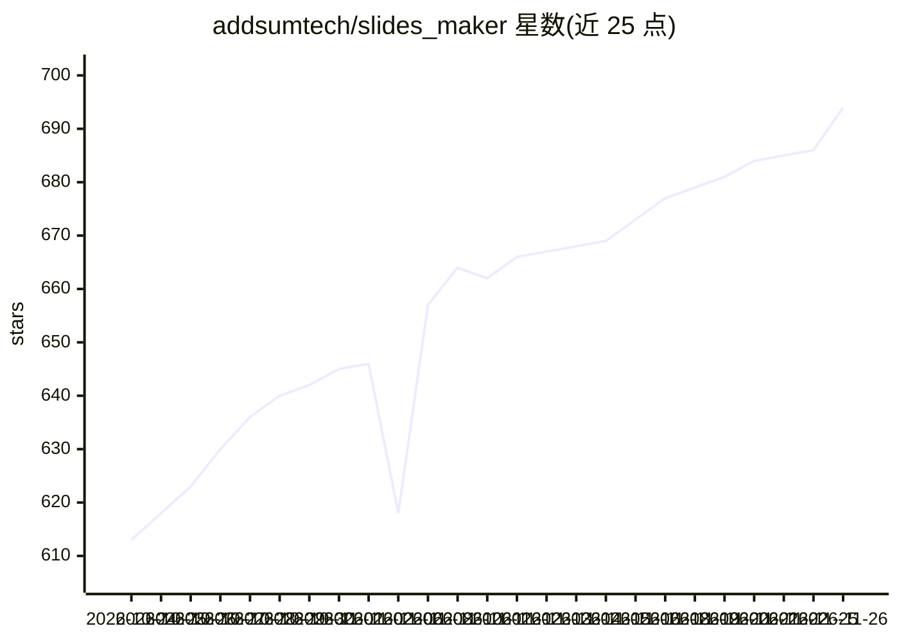

# addsumtech/slides_maker

⭐ 694 · Python · MIT · 推送 2026-11-25 · [GitHub](https://github.com/addsumtech/slides_maker) · [官网](https://slides.addsum.top) · 组织维护 · 中文 README

**面向 Claude Code/Codex 用户的 AI 技能：把论文、代码、文档转为可编辑 PPTX**

以 AI 技能（skill）形式安装到支持技能的 AI 助手（Claude Code、Codex 等）中运行。用户提供论文、仓库、文档或主题，技能经访谈、内容规划、美术指导、构建渲染、独立评审多 agent 流程后生成可在 PowerPoint 中编辑的原生 PPTX，附带演讲备注、点击构建动画、生成脚本与版本历史。内置 30 套模板（每套两种配色、七种页面类型），支持品牌偏好记忆、多级 review（fast/standard/thorough/none）。使用消耗用户自身的 AI 订阅或 API 额度，长文档与图片生成会增加耗时。

## 筛选速览

| 维度 | 判定 | 备注 |
|---|---|---|
| AI 角色 | `ai-native` | 本体是模型或模型工具 |
| 许可风险 | `permissive` | MIT |
| 部署形态 | `library` | 以包/库形式分发 |
| 模型依赖 | — | README 未给出锁定关系 |
| 硬件要求 | — | 无带数字的原话,不猜 |
| 安装摩擦 | `low` | 无编译、无系统依赖或容器化 |
| 成熟度 | — | 结构信号不足 |

## 能力要点

- 生成可编辑的原生 PPTX：文本框、原生形状与原生图表对象，非截图
- 多 agent 流水线：内容规划、美术指导、构建、独立 critic 评审循环与盲读校验
- 30 套内置模板，支持参考已有 PPTX 提取版式与配色
- 支持论文/仓库/Word/Excel/CSV/音视频等多类输入，公式与数据图可编辑

## 适用场景

- 把论文转成组会或答辩演示文稿
- 为课程内容生成课件讲义幻灯片
- 从代码仓库生成产品介绍或技术分享 PPT
- 按公司品牌规范批量产出汇报幻灯

## 场景标签

`多智能体` · 领域:Agent 开发

## 证据(README 行号)

> L16: slide-maker is an open-source AI skill for creating editable presentations. It runs in AI assistants that support s
> L220: |Any agent runtime|Claude Code, Codex and other agents run the same scripts; Codex runs get an extra delivery gate

## 星数曲线

2026-10-24 613 → 2026-11-26 694（+81）

---
*卡片 v1 · prompt 1.4 · 生成 2026-11-26 · 置信度 mid · 依据 README sha `3033658d0201` · [字段定义](../../DATASET.md)*
