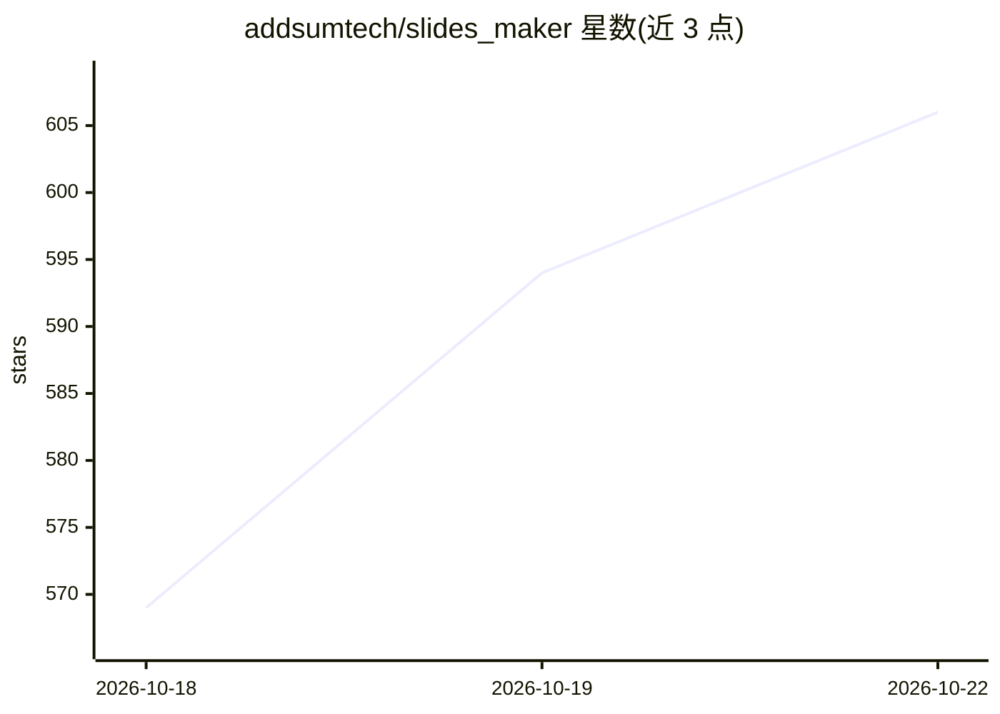

# addsumtech/slides_maker

⭐ 606 · Python · MIT · 推送 2026-10-17 · [GitHub](https://github.com/addsumtech/slides_maker) · [官网](https://slides.addsum.top) · 组织维护 · 中文 README

**在 Codex/Claude Code 中把论文/代码/文档生成为可编辑 PPTX**

面向 Codex 与 Claude Code 用户的多 agent 幻灯片生成技能：一组分工 agent 读取用户提供的论文、仓库或文档（或就主题做检索），规划叙事、逐页排版并生成真实 .pptx 文件；所有文本框、形状、原生图表与公式均为可点击编辑对象，不压平为图片。数字与图表回溯到源材料，生成前由独立 critic agent 审查（布局、对比度、数字一致性），审查强度可由用户设定或跳过。本地运行、输出文件，无云端与分享链接；支持 16:9/4:3/1:1/3:4/9:16/A4 等画幅。附十二个中英双语模板与十五种视觉语言。

## 筛选速览

| 维度 | 判定 | 备注 |
|---|---|---|
| AI 角色 | `ai-native` | 本体是模型或模型工具 |
| 许可风险 | `permissive` | MIT |
| 部署形态 | `library` | 以包/库形式分发 |
| 模型依赖 | — | README 未给出锁定关系 |
| 硬件要求 | — | 无带数字的原话,不猜 |
| 安装摩擦 | `low` | 无编译、无系统依赖或容器化 |
| 成熟度 | — | 结构信号不足 |

## 能力要点

- 生成原生可编辑 PPTX：文本框/形状/原生图表/公式均为可编辑对象
- 多 agent 分工：读取源材料→规划→逐页排版→独立 critic 审查
- 数字与图表回溯到用户源材料，不编造数据
- 十二个双语模板与十五种视觉语言，支持多画幅（含 3:4 小红书、9:16、A4）

## 适用场景

- 把论文或实验报告转成组会/答辩演示
- 将产品仓库或文档生成为发布/路演幻灯片
- 按自有模板风格生成季度汇报或市场报告

## 场景标签

`多智能体` · 领域:Agent 开发

## 证据(README 行号)

> L17: Chat with it in Codex or Claude Code. It isn't one prompt guessing at slides: a small team of specialized agents re
> L22: - ✏️ **A real PowerPoint, not a screenshot.** Every text box, shape, native chart and equation is a click-to-edit o

## 星数曲线

2026-10-18 569 → 2026-10-22 606（+37）

---
*卡片 v1 · prompt 1.4 · 生成 2026-10-21 · 置信度 mid · 依据 README sha `c6357b6c8cb7` · [字段定义](../../DATASET.md)*
