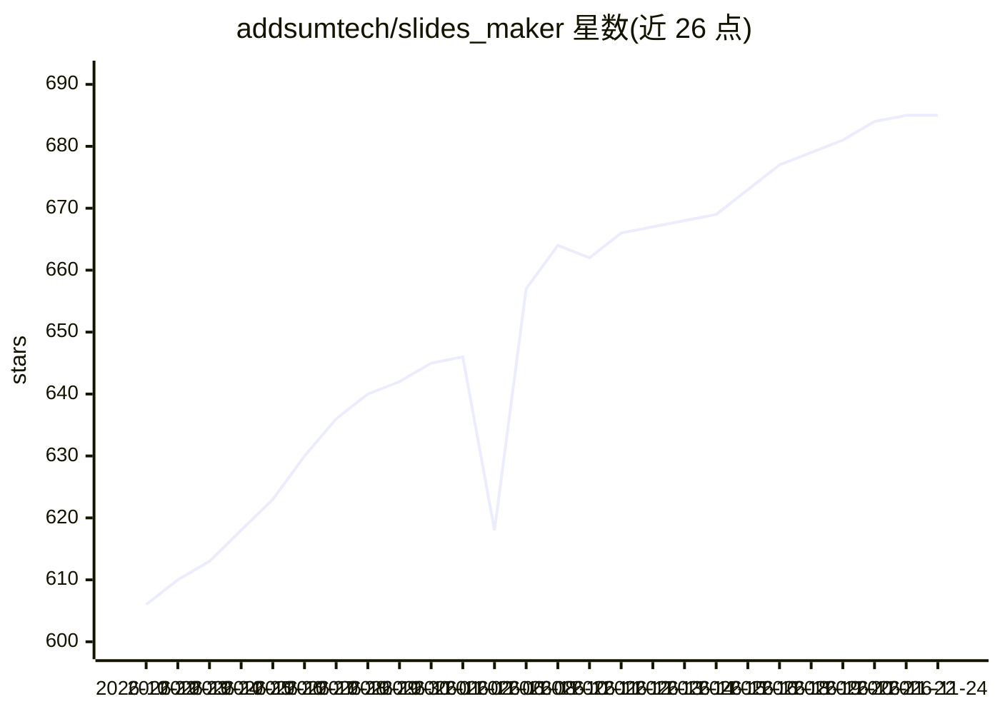

# addsumtech/slides_maker

⭐ 685 · Python · MIT · 推送 2026-11-19 · [GitHub](https://github.com/addsumtech/slides_maker) · [官网](https://slides.addsum.top) · 组织维护 · 中文 README

**在 Codex/Claude Code 中把论文与文档生成可编辑 PPTX 的技能**

一个运行于支持 skills 的 AI 助手（Codex、Claude Code 等）的开源技能：输入论文、代码仓库、文档或主题，先规划内容、确认大纲与设计方向，再生成可在 PowerPoint 中编辑的 .pptx，并附生成脚本、PDF、浏览器预览与演讲者备注。内置 30 个模板（双配色、7 种页面类型），支持从参考 PPTX 提取品牌样式，原生图表与公式、点击构建动画、多尺寸画布。交付前提供 fast/standard/thorough/none 四档独立审校，按轮次核对关键论断与来源。

## 筛选速览

| 维度 | 判定 | 备注 |
|---|---|---|
| AI 角色 | `ai-native` | 本体是模型或模型工具 |
| 许可风险 | `permissive` | MIT |
| 部署形态 | `library` | 以包/库形式分发 |
| 模型依赖 | — | README 未给出锁定关系 |
| 硬件要求 | — | 无带数字的原话,不猜 |
| 安装摩擦 | `low` | 无编译、无系统依赖或容器化 |
| 成熟度 | — | 结构信号不足 |

## 能力要点

- 生成原生可编辑 PPTX：文本框、原生形状与可改数值的原生图表
- 30 个内置模板，每模板含两套配色与 7 种页面类型，支持参考已有 PPTX 提取样式
- 交付前独立审校分 fast/standard/thorough 三档，核对关键论断与来源
- 输入支持论文、仓库、Word、Excel、CSV、图片、音视频，无素材时可在线调研

## 适用场景

- 把论文转成组会或答辩演示文稿
- 从代码仓库生成产品发布或技术介绍 PPT
- 按学校/公司模板风格生成课件与培训材料
- 生成 RedNote/Instagram 竖版轮播卡片

## 场景标签

 · 领域:办公/演示文稿生成

## 证据(README 行号)

> L16: slide-maker is an open-source AI skill for creating editable presentations. It runs in AI assistants that support s
> L189: 5. View and review. See the first render, then choose the review tier. Independent reviewers check content and des
> L33: npx skills add addsumtech/slides_maker

## 星数曲线

2026-10-22 606 → 2026-11-24 685（+79）

---
*卡片 v1 · prompt 1.4 · 生成 2026-11-24 · 置信度 high · 依据 README sha `98756236d928` · [字段定义](../../DATASET.md)*
