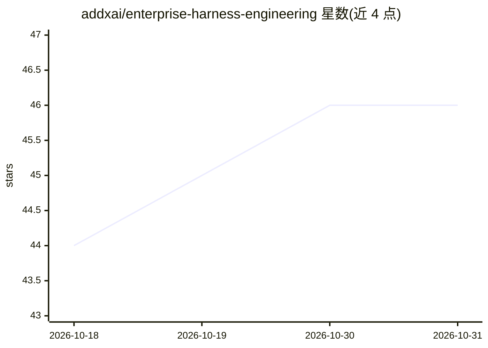

# addxai/enterprise-harness-engineering

⭐ 46 · Python · Apache-2.0 · 推送 2026-04-17 · [GitHub](https://github.com/addxai/enterprise-harness-engineering) · 组织维护 · 中文 README

**企业级 AI Agent 技能库：覆盖研发、运维、安全等产品团队工作流**

一套遵循 Agent Skills 规范的 Markdown 技能集合，共 25 个技能、6 大类别（软件开发、GitLab 集成、监控可观测、SRE 运维、安全合规、市场调研），兼容 Claude Code、Cursor、Windsurf、GitHub Copilot 等 30+ AI 编码代理。技能编码领域专家的判断框架（如 SRE 告警分诊、VOC 分析、代码评审），供编码代理加载后承担不同角色（软件研发 Agent、SRE Agent、数据 Agent 等）。提供 Claude Code 插件市场安装与各代理对应的安装方式。

## 筛选速览

| 维度 | 判定 | 备注 |
|---|---|---|
| AI 角色 | `ai-knowledge` | 知识聚合/清单类 |
| 许可风险 | `permissive` | Apache-2.0 |
| 部署形态 | `self-host` | docker 或自建部署 |
| 模型依赖 | — | README 未给出锁定关系 |
| 硬件要求 | — | 无带数字的原话,不猜 |
| 安装摩擦 | `low` | 无编译、无系统依赖或容器化 |
| 成熟度 | — | 结构信号不足 |

## 能力要点

- 25 个技能按 6 大类别组织，覆盖开发/运维/安全/产品
- 兼容 30+ AI 编码代理（Claude Code、Cursor、Windsurf、Copilot 等）
- 技能编码专家判断框架而非仅 API 文档
- 同一编码代理加载不同技能组合即成为不同角色（7 种 Agent Persona）

## 适用场景

- 为 Claude Code 等 AI 编码代理加载企业工作流技能
- 让 AI 代理承担 SRE 告警处理、代码评审等团队角色
- 按类别检索适合研发或安全团队现成技能

## 场景标签

`代码审查` `提示工程` · 领域:Agent 开发

## 证据(README 行号)

> L121: 25 Skills across 6 categories:
> L180: All skills follow the Agent Skills Specification, compatible with 30+ AI coding agents.

## 星数曲线

2026-10-18 44 → 2026-10-31 46（+2）

---
*卡片 v1 · prompt 1.4 · 生成 2026-10-25 · 置信度 mid · 依据 README sha `f76b1bacfc73` · [字段定义](../../DATASET.md)*
