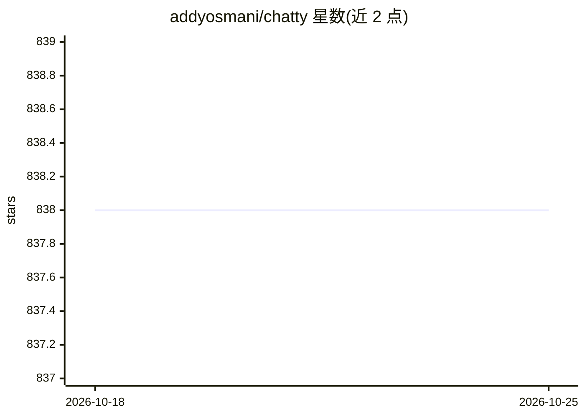

# addyosmani/chatty

⭐ 838 · TypeScript · MIT · 推送 2026-08-09 · [GitHub](https://github.com/addyosmani/chatty) · 个人维护

**浏览器内本地运行 LLM 的私有 AI 聊天应用**

基于 WebGPU 在浏览器本地运行大语言模型的聊天应用：模型全部在客户端硬件上执行，无服务器端处理，初次下载模型后可离线使用。功能包括对话历史、文件问答（pdf 与非二进制文件，本地嵌入与向量存储）、自定义记忆、语音输入、Markdown 渲染、导出聊天记录等。支持 Gemma、Llama2/3、Mistral 等开源模型。以 Next.js 应用提供，可从源码运行或 Docker 部署，另有在线站点。运行 7B 模型约需 6GB 显存的 GPU。

## 筛选速览

| 维度 | 判定 | 备注 |
|---|---|---|
| AI 角色 | `ai-native` | 本体是模型或模型工具 |
| 许可风险 | `permissive` | MIT |
| 部署形态 | `self-host` | docker 或自建部署 |
| 模型依赖 | — | README 未给出锁定关系 |
| 硬件要求 | — | 无带数字的原话,不猜 |
| 安装摩擦 | `low` | 无编译、无系统依赖或容器化 |
| 成熟度 | — | 结构信号不足 |

## 能力要点

- WebGPU 在浏览器本地运行 LLM，无服务器端处理
- 支持 Gemma、Llama2/3、Mistral 等开源模型
- 文件问答（本地嵌入与 MemoryVectorStore）
- 语音输入、自定义记忆、聊天记录导出

## 适用场景

- 在浏览器里私密地与本地 LLM 对话
- 对本地文档提问且数据不出本机
- 离线（模型下载后）使用 AI 聊天

## 场景标签

`聊天机器人` `文档问答` · 领域:对话与助手

## 证据(README 行号)

> L5: **Chatty** is your private AI that leverages WebGPU to run large language models (LLMs) natively & privately in your
> L9: - **In-browser privacy:** All AI models run locally (client side) on your hardware, ensuring that your data is proce

## 星数曲线

2026-10-18 838 → 2026-10-25 838（+0）

---
*卡片 v1 · prompt 1.4 · 生成 2026-10-21 · 置信度 high · 依据 README sha `320da0481969` · [字段定义](../../DATASET.md)*
