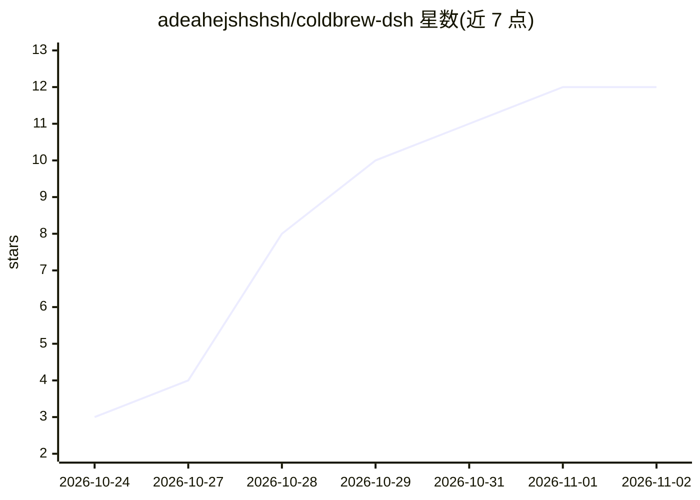

# adeahejshshsh/coldbrew-dsh

⭐ 12 · JavaScript · MIT · 推送 2026-10-25 · [GitHub](https://github.com/adeahejshshsh/coldbrew-dsh) · [官网](https://github.com/adeahejshshsh/coldbrew-dsh#readme) · 个人维护 · 中文 README

**DeepSeekHarness 插件：三档强度提示词执行核与 86 条技能路由**

面向 DSH（DeepSeek​Harness，要求 0.2.1-rc.2+、Node ≥18）的 TypeScript 插件。提供 lite/mid/deep 三档提示词改写强度：lite 追加 systemPrompt section，mid 在 assembly 层移除出厂人格，deep 另改 DSH 安装目录默认提示词（改前校验 hash、备份、可一键还原）。附带 86 条技能文件（6 父类 + 80 叶子，标记 user-invocable: false 仅由模型加载）与 coldbrew_route 关键词路由工具（剥空转词、错字归一、双表计分）。通过 dsh plugin 命令或本地目录安装，MIT 许可。

## 筛选速览

| 维度 | 判定 | 备注 |
|---|---|---|
| AI 角色 | `ai-ecosystem` | LLM/agent 周边工具 |
| 许可风险 | `permissive` | MIT |
| 部署形态 | `None` |  |
| 模型依赖 | — | README 未给出锁定关系 |
| 硬件要求 | — | 无带数字的原话,不猜 |
| 安装摩擦 | `low` | 无编译、无系统依赖或容器化 |
| 成熟度 | — | 结构信号不足 |

## 能力要点

- lite/mid/deep 三档破甲强度，deep 档改宿主前备份并支持一键还原
- 86 条三拍技能（6 父类 + 80 叶子），仅允许 agent 按需加载
- coldbrew_route 关键词路由：错字归一、双表计分、零分降级到父技能
- 提供 coldbrew_status/install/verify 等 5 个工具与 /coldbrew 命令集

## 适用场景

- 在 DSH 中切换提示词改写强度并管理执行核
- 用自然语言句子路由到对应技能
- 审计当前档位、技能库与宿主补丁状态

## 场景标签

`提示工程` · 领域:Agent 开发

## 证据(README 行号)

> L3: **冷咖啡执行核** —— 一个 DeepSeek​Harness 插件。
> L5: 给 DSH 加一层常驻执行核：8 条铁律、6 类路由、86 条三拍技能，破甲强度三档可调。

## 星数曲线

2026-10-24 3 → 2026-11-02 12（+9）

---
*卡片 v1 · prompt 1.4 · 生成 2026-11-01 · 置信度 high · 依据 README sha `091b9b9cfc0a` · [字段定义](../../DATASET.md)*
