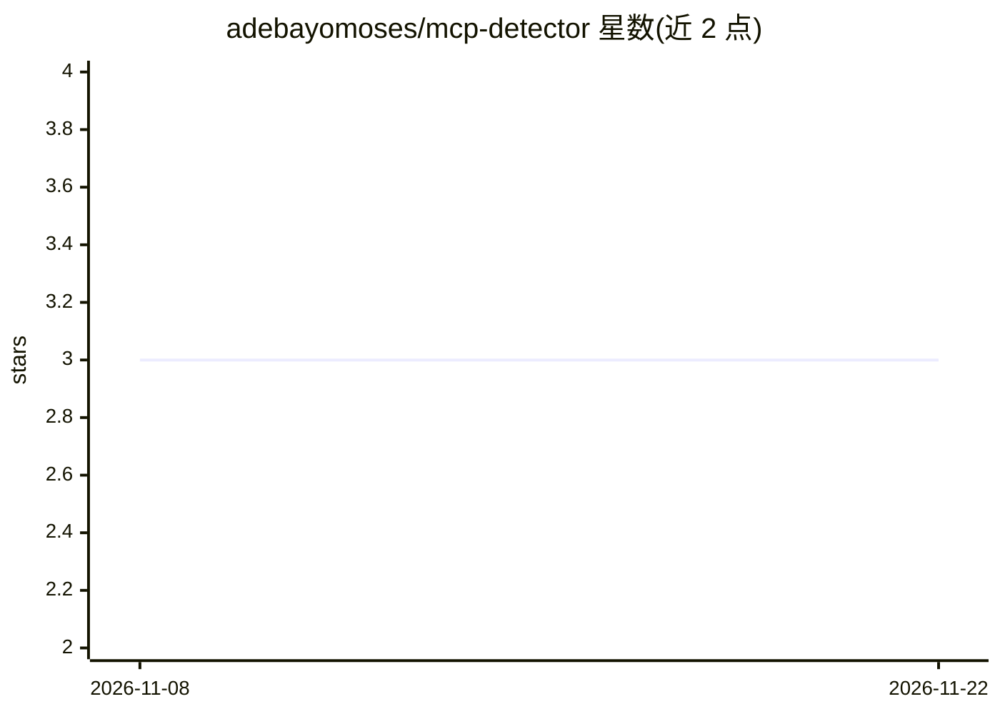

# adebayomoses/mcp-detector

⭐ — · [GitHub]() · 个人维护

**MCP 服务器安全扫描器：评分并列出问题与修复建议**

面向 Model Context Protocol 服务器的安全、可靠性与质量扫描工具，提供 Web 应用、CLI、终端菜单和 GitHub Action 四种使用方式。扫描执行协议握手与 list 调用，覆盖协议、Schema、安全、工具质量和性能五类共 32 条规则，输出健康评分（0-100，按五类加权）和每条发现的具体修复建议。默认被动模式不调用被扫描服务器的工具，--active 模式仅调用只读类工具。本地运行，不外发数据。以 npm 包和 TypeScript 库形式分发。

## 筛选速览

| 维度 | 判定 | 备注 |
|---|---|---|
| AI 角色 | `ai-ecosystem` | LLM/agent 周边工具 |
| 许可风险 | `permissive` | — |
| 部署形态 | `library` | 以包/库形式分发 |
| 模型依赖 | — | README 未给出锁定关系 |
| 硬件要求 | — | 无带数字的原话,不猜 |
| 安装摩擦 | `low` | 无编译、无系统依赖或容器化 |
| 成熟度 | — | 结构信号不足 |

## 能力要点

- 32 条规则覆盖协议、Schema、安全（prompt injection、tool poisoning、SSRF 等）、质量与性能
- 默认被动扫描，不调用被测服务器的工具；--active 仅限只读类工具
- 0-100 健康评分按安全 30%/协议 20% 等五类加权，每条发现附证据与修复建议
- 提供 Web 应用、CLI、GitHub Action 与库四种集成方式，全程本地运行

## 适用场景

- 安装 MCP 服务器前先扫描是否存在 tool poisoning 或权限风险
- 在 CI 中用 GitHub Action 对 PR 中的 MCP 服务器做自动化检查
- 批量扫描 MCP registry 并生成评分与徽章

## 场景标签

`网络安全` · 领域:学习与行业

## 证据(README 行号)

> L4: Security, reliability, and quality scanner for Model Context Protocol (MCP) servers.
> L14: AI assistants such as Claude can be given extra abilities by add-ons (called *MCP servers*). Some are well built, s
> L32: Requires Node.js 22.12 or newer. No install needed:

## 星数曲线

2026-11-08 3 → 2026-11-22 3（+0）

---
*卡片 v1 · prompt 1.4 · 生成 2026-11-22 · 置信度 high · 依据 README sha `204e6327a458` · [字段定义](../../DATASET.md)*
