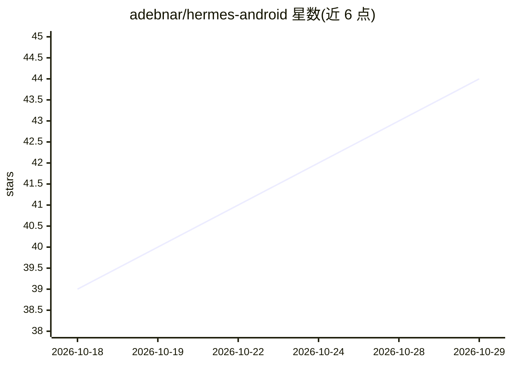

# adebnar/hermes-android

⭐ 44 · Kotlin · GPL-3.0 · 推送 2026-10-03 · [GitHub](https://github.com/adebnar/hermes-android) · 个人维护

**Hermes agent 网关的 Android 原生客户端：聊天加全量管理**

用 Kotlin 与 Jetpack Compose（Material 3）编写的 Android 应用，连接远程 Hermes agent 网关（经 Tailscale、VPN 或局域网），提供流式聊天、会话/模型/配置档管理、定时任务（cron）增删改、用量分析、消息集成与设置编辑（写入网关配置）。认证支持 loopback 会话令牌或用户名/密码（含 cookie 与 WebSocket 票据流程），凭据加密存储。以签名 APK 直接安装，也可用 Android Studio 自行构建。

## 筛选速览

| 维度 | 判定 | 备注 |
|---|---|---|
| AI 角色 | `ai-ecosystem` | LLM/agent 周边工具 |
| 许可风险 | `viral` | GPL-3.0 |
| 部署形态 | `desktop` | 安装包/桌面程序 |
| 模型依赖 | — | README 未给出锁定关系 |
| 硬件要求 | — | 无带数字的原话,不猜 |
| 安装摩擦 | `medium` | 含编译或系统依赖之一 |
| 成熟度 | — | 结构信号不足 |

## 能力要点

- 连接 Hermes 网关的聊天与会话/模型/cron/用量/消息集成的管理界面
- 令牌与密码两种认证模式，凭据加密存储，401 自动重认证
- 多租户配置档各有强调色，Agent Activity 实时活动流
- 提供签名 APK 直接安装，无需构建工具

## 适用场景

- 在手机上通过 Tailscale/VPN/局域网使用自己的 Hermes agent
- 随时管理 agent 的定时任务、模型切换与用量
- 在多租户配置档间切换并查看各租户的活动流

## 场景标签

`AI 助手` · 领域:对话与助手

## 证据(README 行号)

> L9: A native Android client for the **Hermes agent gateway** — a phone-friendly companion to
> L11: private VPN, or your local network, and gives you full chat plus the management surface: sessions, models,

## 星数曲线

2026-10-18 39 → 2026-10-29 44（+5）

---
*卡片 v1 · prompt 1.4 · 生成 2026-10-25 · 置信度 high · 依据 README sha `ee31877747de` · [字段定义](../../DATASET.md)*
