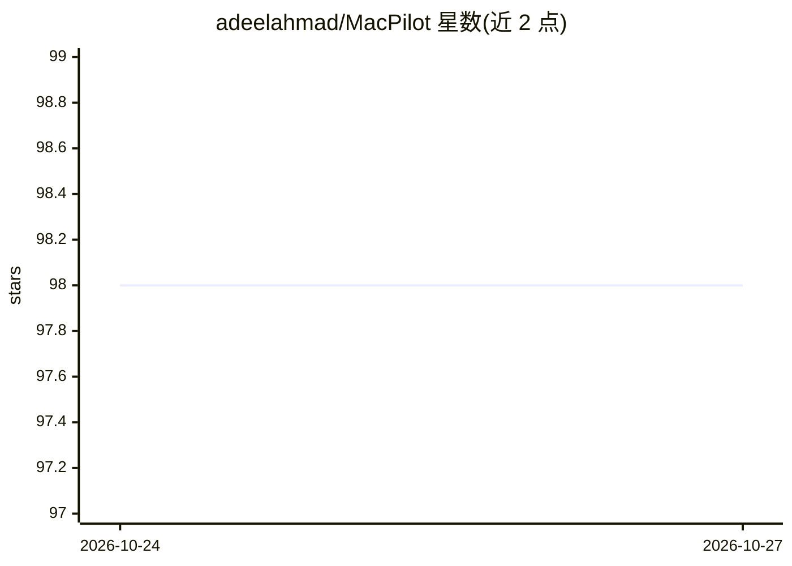

# adeelahmad/MacPilot

⭐ 98 · Python · 推送 2026-10-20 · [GitHub](https://github.com/adeelahmad/MacPilot) · 组织维护

**用自然语言驱动 macOS UI 自动化的框架**

面向 macOS 的 UI 自动化框架：用户以英文自然语言下达指令，由 GPT 分析层解析并生成动作计划，再经 Actor 系统、AppleScript、Accessibility API、Apple Vision（OCR 与元素检测）等原生技术执行，支持 Chrome、Finder、系统与菜单等控制，并带状态跟踪、模式注册与自动错误恢复等机制。以 Python 库形式提供（pip 安装），要求 macOS 平台；UI、CLI、本地 LLM 支持等仍列于路线图未实现。

## 筛选速览

| 维度 | 判定 | 备注 |
|---|---|---|
| AI 角色 | `ai-native` | 本体是模型或模型工具 |
| 许可风险 | `none` | — |
| 部署形态 | `library` | 以包/库形式分发 |
| 模型依赖 | — | README 未给出锁定关系 |
| 硬件要求 | — | 无带数字的原话,不猜 |
| 安装摩擦 | `low` | 无编译、无系统依赖或容器化 |
| 成熟度 | — | 结构信号不足 |

## 能力要点

- 自然语言指令经 GPT 分析层转为动作计划执行
- Apple Vision OCR、AppleScript、Accessibility API 等原生集成
- Actor 系统与可注册复用的 Pattern 模式系统
- 状态跟踪与自动错误恢复（Self-healing）机制

## 适用场景

- 用英文指令自动化重复的 macOS 界面操作
- 对 macOS 应用做自然语言驱动的 UI 测试
- 构建桌面 RPA 工作流（Chrome/Finder/系统控制）

## 场景标签

`GUI 自动化` `工作流自动化` · 领域:效率与自动化

## 证据(README 行号)

> L20: MacPilot is a state-of-the-art macOS UI automation framework that combines native Apple technologies with GPT intel
> L32: - **GPT Integration** - Natural language instruction processing
> L63:     A[Natural Language Instructions] --> B[GPT Analysis Layer]

## 星数曲线

2026-10-24 98 → 2026-10-27 98（+0）

---
*卡片 v1 · prompt 1.4 · 生成 2026-10-23 · 置信度 mid · 依据 README sha `5533d5c3b953` · [字段定义](../../DATASET.md)*
