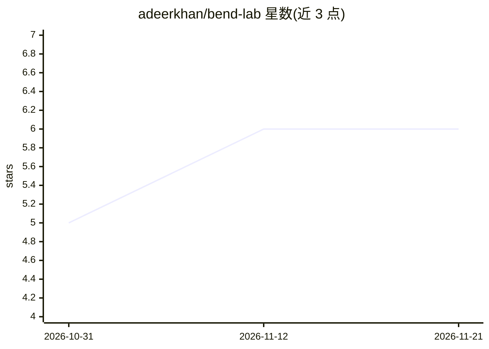

# adeerkhan/bend-lab

⭐ 6 · Python · MIT · 推送 2026-11-19 · [GitHub](https://github.com/adeerkhan/bend-lab) · 个人维护

**面向研究者的 Bend 语言机器学习实验集，含可复现验证**

用 Bend 语言从零编写的机器学习实验集合，覆盖分类、扩散、流匹配、Transformer、Mamba 等任务，模型在自研 BendTorch 框架上训练。每个实验配有同运算顺序的 NumPy 双实现与 scikit-learn/PyTorch 等外部参照做三路交叉验证，结果通过 make check 门禁检查。提供 make doctor 读取机器资源生成编译预算、内存 cgroup 守护脚本防 OOM、本地运行仪表盘与批量实验流水线。README 同时记录了编译内存开销与预设尚未全部可构建的限制。

## 筛选速览

| 维度 | 判定 | 备注 |
|---|---|---|
| AI 角色 | `ai-native` | 本体是模型或模型工具 |
| 许可风险 | `permissive` | MIT |
| 部署形态 | `None` |  |
| 模型依赖 | — | README 未给出锁定关系 |
| 硬件要求 | — | 无带数字的原话,不猜 |
| 安装摩擦 | `low` | 无编译、无系统依赖或容器化 |
| 成熟度 | — | 结构信号不足 |

## 能力要点

- 每个实验配 NumPy 双实现与 PyTorch/scikit-learn 参照做三路验证
- make doctor 生成编译预算，bend-guard.sh 以内存 cgroup 防止编译 OOM
- 本地仪表盘记录每次运行的 CPU/RAM/GPU 利用率与损失曲线
- 含 ViT 扩散、流匹配、Transformer、Mamba 等 17 个实验任务

## 适用场景

- 在 Bend 语言上复现并核对机器学习模型的数值结果
- 研究可复现的实验记录与结果验证流程
- 在小数据集上从零训练扩散与 Transformer 类模型

## 场景标签

`科研工具` · 领域:学习与行业

## 证据(README 行号)

> L5: **Machine learning, built in Bend.** Models are written from scratch in
> L7: BendTorch. The repository is an
> L12: Every number comes from a program in the repository and is checked three ways:
> L158: `make check` is the gate. It checks the proofs and the kernel with Lean, runs

## 星数曲线

2026-10-31 5 → 2026-11-21 6（+1）

---
*卡片 v1 · prompt 1.4 · 生成 2026-11-20 · 置信度 high · 依据 README sha `0f2a4bf0e8b4` · [字段定义](../../DATASET.md)*
