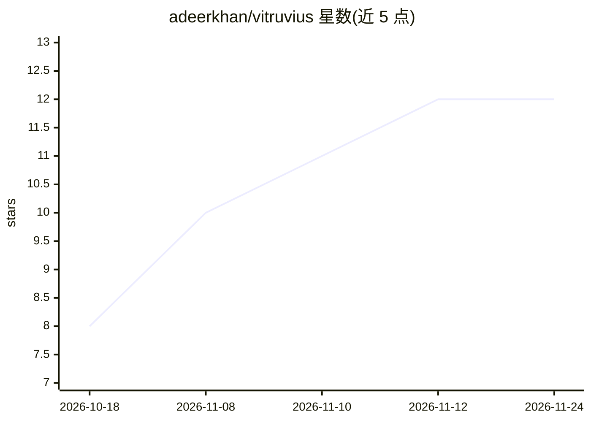

# adeerkhan/vitruvius

⭐ 12 · JavaScript · MIT · 推送 2026-11-08 · [GitHub](https://github.com/adeerkhan/vitruvius) · [官网](https://adeerkhan.github.io/vitruvius/) · 个人维护

**面向工程师的工程研究 agent：检索-验证-溯源一条龙**

Vitruvius 是一个工程研究 agent，以 5 个学科、27 个技能的形式组织，围绕 discover→read→synthesize→verify→review 的共享研究循环运行。每个声明要求可核查出处（.provenance.md sidecar），区分 verified/inferred/blocked/unverified 状态，并用带评分基准的盲验证器做对抗校验（公开结果与局限）。以 npm 包分发，命令以斜杠技能形式调用，支持 --deep/--quick 及预算上限控制。基准结果自身标注方差较大，属测量值而非认证。

## 筛选速览

| 维度 | 判定 | 备注 |
|---|---|---|
| AI 角色 | `ai-native` | 本体是模型或模型工具 |
| 许可风险 | `permissive` | MIT |
| 部署形态 | `library` | 以包/库形式分发 |
| 模型依赖 | — | README 未给出锁定关系 |
| 硬件要求 | — | 无带数字的原话,不猜 |
| 安装摩擦 | `low` | 无编译、无系统依赖或容器化 |
| 成熟度 | — | 结构信号不足 |

## 能力要点

- 5 学科 × 27 技能，统一的研究循环方法与斜杠命令入口
- 带盲验证器的对抗基准（20 案例，检出 0 假批准/0 假拦截）与确定性 PASS 评分夹具
- 每条声明溯源到可核查来源，provenance sidecar 与 fail-closed 校验器
- 支持 --deep 多 agent 覆盖、--quick 快查与 turns/budget 上限

## 适用场景

- 工程文献缺口分析与学术证据检索（OpenAlex/arXiv/Semantic Scholar）
- 设计备选方案生成与 FMEA 失效模式头脑风暴
- 标准/论文/规范的结构化摘要与对抗式评审
- 把论文或 GitHub 仓库转成推广帖文与 HTML 卡片

## 场景标签

`科研工具` · 领域:学习与行业

## 证据(README 行号)

> L20: Vitruvius is an **engineering research agent** that runs a **discover → read → synthesize → verify → review** loop 
> L127: |`/gap-analysis`|Systematic literature gap identification via triangulation (OpenAlex, arXiv, web)|

## 星数曲线

2026-10-18 8 → 2026-11-24 12（+4）

---
*卡片 v1 · prompt 1.4 · 生成 2026-11-18 · 置信度 mid · 依据 README sha `af4f758433f7` · [字段定义](../../DATASET.md)*
