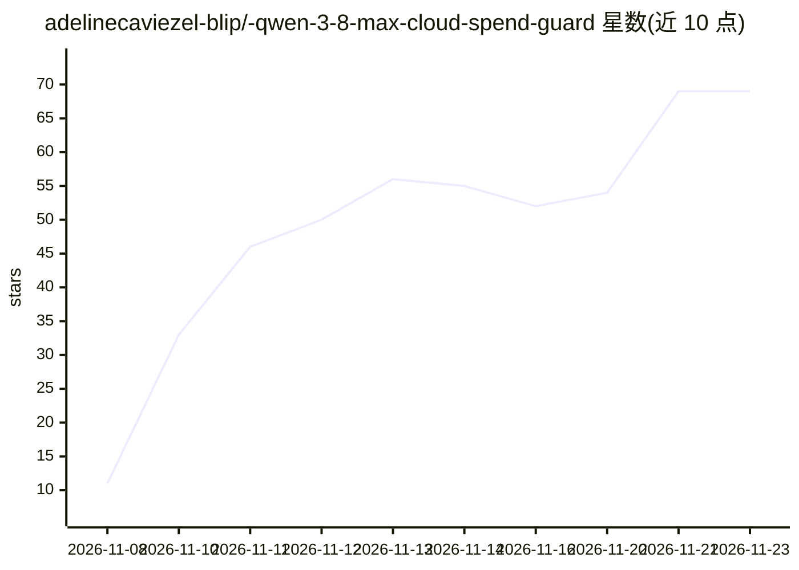

# adelinecaviezel-blip/-qwen-3-8-max-cloud-spend-guard

⭐ 69 · 推送 2026-11-05 · [GitHub](https://github.com/adelinecaviezel-blip/-qwen-3-8-max-cloud-spend-guard) · [官网](https://app.coregold.io/signup?invite_code=ADvlj9b) · 组织维护 · 中文 README

**面向海外算力租用的虚拟卡付费控制服务宣传页**

README 为 CoreGold 商业虚拟卡服务的推广文档，而非软件项目：面向在 RunPod、Lambda Labs、Vast.ai 等海外平台租用 GPU 实例部署 Qwen 推理集群的出海团队，主张以充值 USDT 开通限额虚拟卡的方式应对平台 AVS 验资拒付与忘记释放实例导致的持续扣费，机制包括单卡限额触发 Decline 自动停机、跑完任务注销卡片余额退回。全文为接入步骤说明与对比论证，无代码、无安装运行方式。

## 筛选速览

| 维度 | 判定 | 备注 |
|---|---|---|
| AI 角色 | `ai-enhanced` | 去掉 AI 部分产品仍成立 |
| 许可风险 | `none` | — |
| 部署形态 | `None` |  |
| 模型依赖 | — | README 未给出锁定关系 |
| 硬件要求 | — | 无带数字的原话,不猜 |
| 安装摩擦 | `low` | 无编译、无系统依赖或容器化 |
| 成熟度 | — | 结构信号不足 |

## 能力要点

- USDT 充值转 USD 资金池并按机型派发限额虚拟卡
- 单卡费用达限额时底层拒绝扣划、平台自动停机
- 任务结束后注销卡片、余额退回母账户

## 适用场景

- 出海团队为海外 GPU 租用平台绑定可限额的付费卡片
- 防止测试后未释放实例导致的持续扣费

## 场景标签

 · 领域:支付/云成本管理

## 证据(README 行号)

> L2: Qwen3.8-Max 海外私有算力租用防穿透：CoreGold 虚拟卡解决 RunPod / Lambda 验资秒拒与天价账单
> L28: 👉 **立即进入 CoreGold 开卡控制台**

## 星数曲线

2026-11-08 11 → 2026-11-23 69（+58）

---
*卡片 v1 · prompt 1.4 · 生成 2026-11-18 · 置信度 low · 依据 README sha `c7808a39b204` · [字段定义](../../DATASET.md)*
