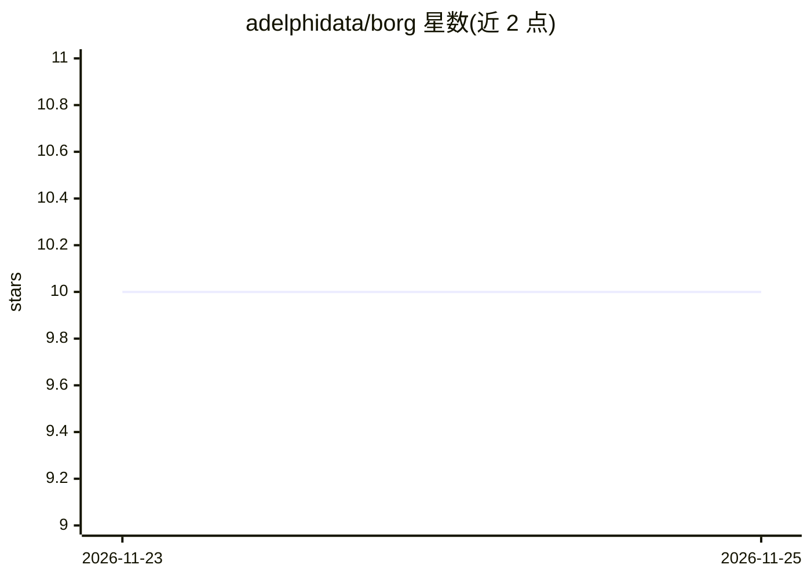

# adelphidata/borg

⭐ 10 · Rust · MIT · 推送 2026-11-23 · [GitHub](https://github.com/adelphidata/borg) · 组织维护

**本地运行的安全优先个人 AI 助理，可接管任务与设备**

以 Rust 编写、以桌面应用与 CLI 分发的个人 AI 助理：后台守护进程之上提供桌面端、终端 UI 与浏览器 UI。运行时自行编写工具脚本，并在 macOS Seatbelt 或 Linux Bubblewrap 沙箱中执行（默认无网络、隔离密钥）。支持工作记忆、Markdown 笔记与长期记忆，提供 Telegram/Slack 等 9 类消息通道、定时任务与心跳、Gmail/Notion/Linear 集成、MCP 服务器接入、会议转录与计算机操作。数据保存在本地 ~/.borg，无账号无埋点。

## 筛选速览

| 维度 | 判定 | 备注 |
|---|---|---|
| AI 角色 | `ai-native` | 本体是模型或模型工具 |
| 许可风险 | `permissive` | MIT |
| 部署形态 | `None` |  |
| 模型依赖 | local-ok | 支持本地模型 |
| 硬件要求 | — | 无带数字的原话,不猜 |
| 安装摩擦 | `low` | 无编译、无系统依赖或容器化 |
| 成熟度 | — | 结构信号不足 |

## 能力要点

- 工具在 Seatbelt/Bubblewrap 沙箱中运行，默认断网并屏蔽敏感路径
- 支持 Anthropic/OpenAI/Gemini 等 10+ 供应商及 Ollama、llama.cpp 本地模型
- 运行时自写工具脚本（HMAC 封印）并支持 MCP 服务器扩展
- 多通道消息接入、定时任务、会议记录与计算机操作

## 适用场景

- 在本地离线运行一个不外传数据的个人助理
- 通过 Telegram/Slack 等随时给助理下任务
- 让助理自动执行定时任务并在睡后继续运行
- 记录会议并自动转录生成纪要

## 场景标签

`AI 助手` · 领域:对话与助手

## 证据(README 行号)

> L5:  Your personal AI assistant, employee, developer, analyst and sidekick. Security-first and open source.
> L18: - **One assistant, everywhere.** Borg runs as a background daemon with a desktop app, a terminal UI and a browser U
> L21: - **Any model.** Use Anthropic, OpenAI, Gemini, OpenRouter, Bedrock, Azure, Vertex AI, DeepSeek, Groq, xAI, your Cl

## 星数曲线

2026-11-23 10 → 2026-11-25 10（+0）

---
*卡片 v1 · prompt 1.4 · 生成 2026-11-23 · 置信度 high · 依据 README sha `d1da8da36114` · [字段定义](../../DATASET.md)*
