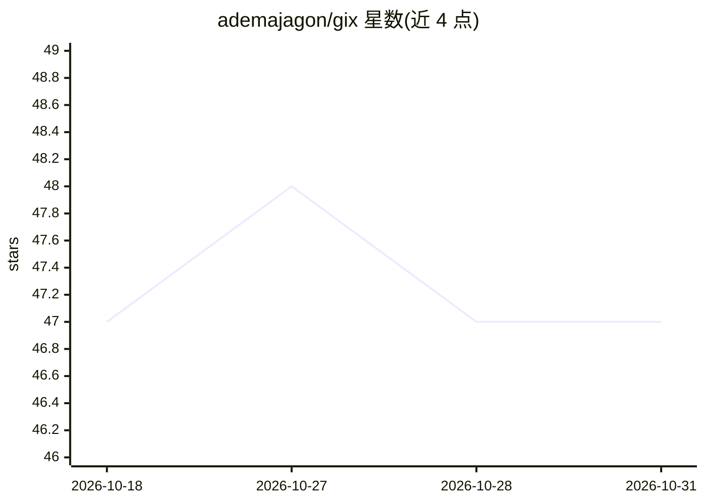

# ademajagon/gix

⭐ 47 · Go · MIT · 推送 2026-06-22 · [GitHub](https://github.com/ademajagon/gix) · 个人维护

**AI 生成 Git 提交信息的命令行工具，支持拆分大改动**

Go 编写的单二进制 CLI：读取暂存区 diff，生成 Conventional Commits 格式的提交信息，用户可接受、编辑或重新生成。gix split 基于嵌入向量的 hunk 聚类，将大改动按语义相似度分组成多个原子提交。支持 OpenAI、Gemini 与本地 Ollama 三种 provider，自带 API key 配置，用 Ollama 可完全离线运行。安装途径为 Homebrew（macOS）、Releases 二进制或 go install；split 功能标注为 beta。

## 筛选速览

| 维度 | 判定 | 备注 |
|---|---|---|
| AI 角色 | `ai-native` | 本体是模型或模型工具 |
| 许可风险 | `permissive` | MIT |
| 部署形态 | `library` | 以包/库形式分发 |
| 模型依赖 | local-ok | 支持本地模型 |
| 硬件要求 | — | 无带数字的原话,不猜 |
| 安装摩擦 | `low` | 无编译、无系统依赖或容器化 |
| 成熟度 | — | 结构信号不足 |

## 能力要点

- 从 staged diff 生成 Conventional Commits 提交信息
- gix split 基于嵌入聚类的 hunk 分组，一次大改动拆成多个原子提交
- 支持 OpenAI/Gemini/Ollama，本地 Ollama 可完全离线运行
- 单二进制，无运行时依赖

## 适用场景

- 让 AI 代写符合规范的 Git 提交信息
- 把一个混杂的大提交拆成多个语义清晰的原子提交
- 离线环境下用本地模型生成提交信息

## 场景标签

 · 领域:开发者工具/Git

## 证据(README 行号)

> L8: `gix` generates conventional commit messages from your staged diff and splits large changes into small commits.
> L21: - Multiple AI providers, OpenAI, Gemini or Ollama (local)

## 星数曲线

2026-10-18 47 → 2026-10-31 47（+0）

---
*卡片 v1 · prompt 1.4 · 生成 2026-10-25 · 置信度 high · 依据 README sha `be2ec2bd3865` · [字段定义](../../DATASET.md)*
