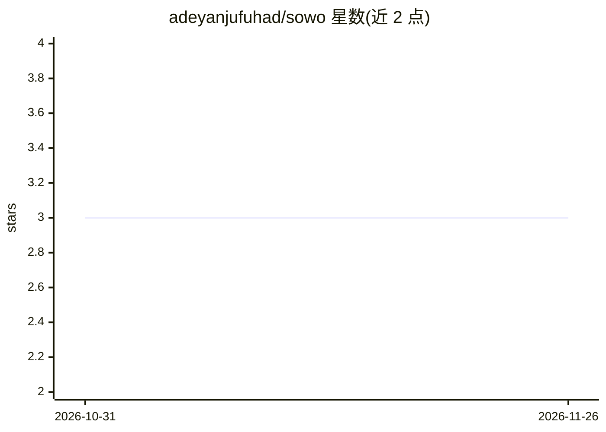

# adeyanjufuhad/sowo

⭐ 3 · Python · MIT · 推送 2026-11-20 · [GitHub](https://github.com/adeyanjufuhad/sowo) · [官网](https://web-one-mu-94.vercel.app) · 个人维护

**尼日利亚 WhatsApp 卖家的 AI 销售助手：自动回复与议价**

面向在 WhatsApp 上售货的尼日利亚小商家的销售助手：买家发消息后自动回复、查库存、按商家设定的底价议价（模型不可见底价）、发送 Paystack 付款链接或银行账户信息，并经 webhook 或商家手动确认后通知发货。基于开源权重 Qwen3 模型，支持 Pidgin 和英语；架构上模型只负责理解消息、选择工具与组织措辞，价格、总额与库存变动由服务端代码决定。MIT 许可，为 OSCA Ile-Ife 的 OPEN//BUILD 2026 黑客松项目。

## 筛选速览

| 维度 | 判定 | 备注 |
|---|---|---|
| AI 角色 | `ai-native` | 本体是模型或模型工具 |
| 许可风险 | `permissive` | MIT |
| 部署形态 | `library` | 以包/库形式分发 |
| 模型依赖 | local-ok | 支持本地模型 |
| 硬件要求 | — | 无带数字的原话,不猜 |
| 安装摩擦 | `low` | 无编译、无系统依赖或容器化 |
| 成熟度 | — | 结构信号不足 |

## 能力要点

- 模型只选择工具与措辞，价格、总额、库存与支付确认全部由服务端代码判定
- 底价对模型不可见（不出现在提示、工具输出或日志中），金额全程以整数 kobo 计算
- 支持 Paystack 链接与银行转账两种按店铺配置的收款模式
- 无后端配置时浏览器内运行 mock 后端，离线可用的 demo 模式

## 适用场景

- WhatsApp 上经营小店的卖家自动化询价与议价回复
- 夜间或忙碌时段自动接单并核验收款后再发货
- 用银行转账收款并需防假转账截图的商家

## 场景标签

`聊天机器人` · 领域:对话与助手

## 证据(README 行号)

> L18: An AI sales assistant for Nigerian vendors who sell on WhatsApp. When a buyer messages, Ṣòwò replies instantly, che
> L49: A chatbot alone doesn't fix this, and can make it worse. A model that sets prices can be talked into anything ("ign
> L33: |Model|Qwen3, open weights, through an OpenAI-compatible API (Groq) or Ollama locally|—|

## 星数曲线

2026-10-31 3 → 2026-11-26 3（+0）

---
*卡片 v1 · prompt 1.4 · 生成 2026-11-22 · 置信度 mid · 依据 README sha `f02d7ab226d9` · [字段定义](../../DATASET.md)*
