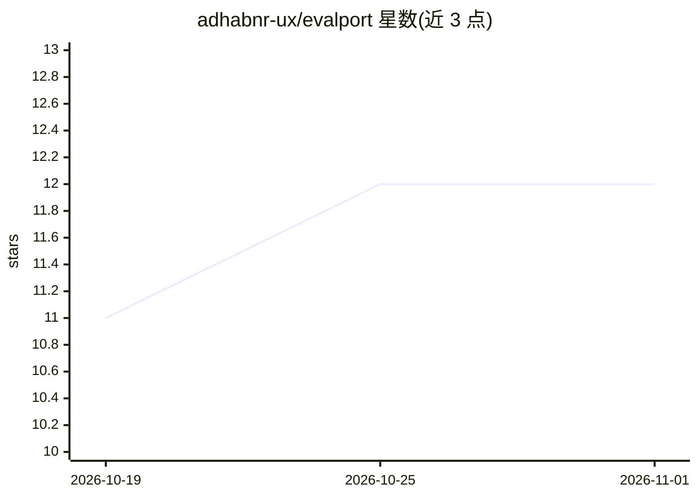

# adhabnr-ux/evalport

⭐ 12 · Python · Apache-2.0 · 推送 2026-10-15 · [GitHub](https://github.com/adhabnr-ux/evalport) · 个人维护

**LLM 评测数据跨框架互通的开放规范与转换器集**

EvalPort 是一个便携式 LLM 评测开放规范（v1.0.0-rc.5，Apache 2.0）：定义可跨框架共享的测试用例、评分器、套件与结果格式，使 DeepEval、Promptfoo、Ragas、Inspect AI、LangSmith、MLflow 等评测框架间的数据集与结果可双向转换而不丢失语义。提供 Python SDK（openeval）、npm CLI（evalport-cli）、GitHub Action 与 pre-commit 钩子；`evalport run` 可直接对 OpenAI/Anthropic 或 OpenAI 兼容端点执行套件，内置 Tier 1 本地评分器与 LLM-as-judge 等评分类型。仓库含 71 个独立框架适配器包与 14 个公共基准（8,012 条用例）的转换套件。项目自述为 pre-1.0，5 个 RFC 处于开放评论期。

## 筛选速览

| 维度 | 判定 | 备注 |
|---|---|---|
| AI 角色 | `ai-ecosystem` | LLM/agent 周边工具 |
| 许可风险 | `permissive` | Apache-2.0 |
| 部署形态 | `library` | 以包/库形式分发 |
| 模型依赖 | locked-api |  |
| 硬件要求 | — | 无带数字的原话,不猜 |
| 安装摩擦 | `medium` | 含编译或系统依赖之一 |
| 成熟度 | `idea` | |

## 能力要点

- 定义评测用例/评分器/套件/结果的跨框架便携规范，71 个独立适配器包覆盖 Ragas、LangSmith、MLflow 等
- evalport run 直接执行套件：OpenAI/Anthropic 及任意 OpenAI 兼容端点，--dry-run 先估算成本
- Tier 1 评分器零外部依赖本地运行（exact_match/regex/json_schema/json_path 等），支持 llm_judge 与 semantic_similarity
- Benchmark Hub 将 14 个公共基准转换为 22 个通过 CI 校验的套件（8,012 条用例）

## 适用场景

- 把评测数据集从 Promptfoo/DeepEval 迁到 Inspect AI 等其他框架而不重写
- 在 CI 中校验 *.evalport.json 套件文件的规范性
- 用统一格式汇总多个评测框架的结果并对比

## 场景标签

`模型评测` · 领域:评测与运维

## 证据(README 行号)

> L13: EvalPort is an open specification for portable LLM evaluation test cases, graders, suites, and results. It enables 
> L110: |Promptfoo → EvalPort|✅ CLI + SDK|

## 星数曲线

2026-10-19 11 → 2026-11-01 12（+1）

---
*卡片 v1 · prompt 1.4 · 生成 2026-11-01 · 置信度 mid · 依据 README sha `45aaa5efccfc` · [字段定义](../../DATASET.md)*
