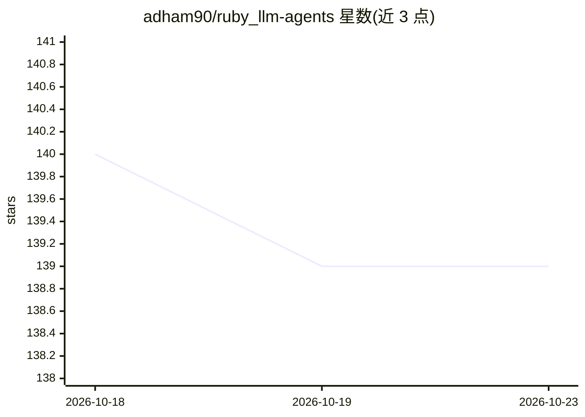

# adham90/ruby_llm-agents

⭐ 139 · Ruby · MIT · 推送 2026-10-09 · [GitHub](https://github.com/adham90/ruby_llm-agents) · [官网](https://rubygems.org/gems/ruby_llm-agents) · 个人维护

**Rails 引擎：构建并监控 LLM AI agent，含成本与预算管理**

基于 RubyLLM 的 Rails engine，用声明式 DSL 定义 AI agent（模板型 .call 与对话型 .ask），通过 RubyLLM 支持 OpenAI、Anthropic、Google Gemini、DeepSeek 等提供商。内置执行追踪与 token/成本统计、多租户隔离、日/月预算限制、自动重试与模型回退、熔断器、评测套件（精确匹配/LLM judge 等），并挂载 Turbo 实时监控仪表盘。要求 Ruby>=3.1、Rails>=7.0、RubyLLM>=1.16.0，MIT 许可。

## 筛选速览

| 维度 | 判定 | 备注 |
|---|---|---|
| AI 角色 | `ai-ecosystem` | LLM/agent 周边工具 |
| 许可风险 | `permissive` | MIT |
| 部署形态 | `None` |  |
| 模型依赖 | locked-api |  |
| 硬件要求 | — | 无带数字的原话,不猜 |
| 安装摩擦 | `low` | 无编译、无系统依赖或容器化 |
| 成熟度 | — | 结构信号不足 |

## 能力要点

- 声明式 Agent DSL（模板 .call 与对话 .ask）
- 执行追踪与按 agent/模型/租户/时段的成本分析
- 自动重试、模型回退、熔断器与日/月预算限制
- Turbo 实时监控仪表盘与评测套件

## 适用场景

- 在 Rails 应用中定义并运行 LLM agent
- 生产环境监控 agent 的 token 用量与花费
- 多租户场景下为各租户设独立 API key 与预算
- 对 agent 质量做评测与回归测试

## 场景标签

`Agent 框架` `LLM 可观测性` `模型评测` · 领域:Agent 开发

## 证据(README 行号)

> L5: > **Production-ready Rails engine for building, managing, and monitoring LLM-powered AI agents**
> L14: Build intelligent AI agents in Ruby with a clean DSL, automatic execution tracking, cost analytics, budget controls

## 星数曲线

2026-10-18 140 → 2026-10-23 139（-1）

---
*卡片 v1 · prompt 1.4 · 生成 2026-10-23 · 置信度 high · 依据 README sha `be55f06deee6` · [字段定义](../../DATASET.md)*
